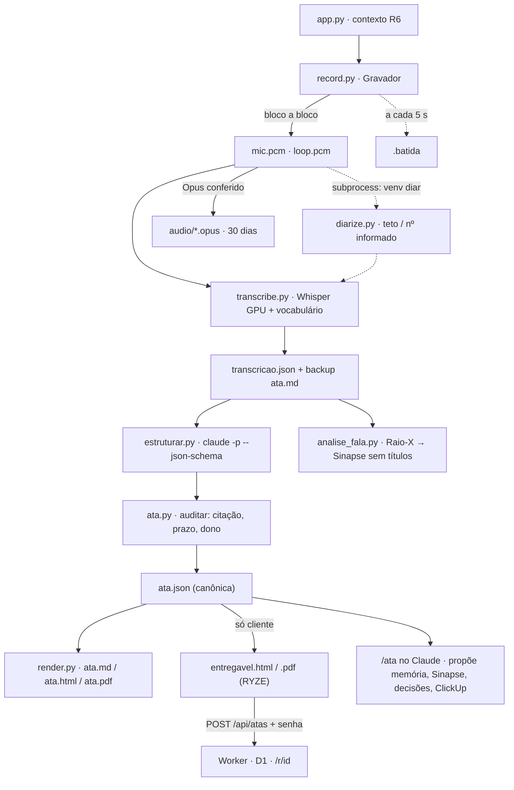

# Atas — Arquitetura e funcionamento (v2)

> Reescrito em 30/09/2026, na v2, para uma pessoa entender o sistema **sozinha**. Cobre o
> caminho inteiro de uma reunião — do microfone à ata estruturada e ao PDF —, os dois
> ambientes Python, o que fica fora do git, os números medidos e o que quebra quando se
> esquece de um detalhe. A v1 (jul–set/2026) está no histórico do git e em §15.
>
> O manual do dia a dia é o [README.md](../README.md). O contrato da v2 é
> [BRIEFING-V2.md](BRIEFING-V2.md).

---

## 0 · Como ler

Cinco minutos: §1, §2 e §13. Mexer na gravação: §3 e §4. Na transcrição e nos falantes: §5
e §6. Na ata: §7. No Worker: §10. Resolver um problema agora: §11 (receitas) e §14.

---

## 1 · O sistema em um parágrafo

Uma janela (`app.py`) pergunta o contexto da reunião — título, **tipo**, projeto e quem vai
falar do outro lado — e grava **duas fontes físicas separadas**: o microfone ("Você") e o
loopback do alto-falante ("Participante"). Cada bloco de 100 ms vai **para o disco na hora**,
num `.pcm` dentro da pasta da reunião, e uma batida a cada 5 s diz que o gravador está vivo.
Ao parar, o `pipeline.py` transcreve cada canal na GPU (faster-whisper `large-v3-turbo`, com
o vocabulário do contexto), separa as vozes do loopback (sherpa-onnx, noutro venv) usando o
número de participantes informado, e escreve um backup `.md` antes de qualquer coisa que
dependa de rede. Depois chama o **Claude Code sem interação** (`claude -p`) com um JSON Schema
fechado, e **audita** a resposta contra a transcrição: todo item precisa de uma citação
literal, e prazo sem a expressão dita vira lacuna. Da ata canônica (`ata.json`) saem o `.md`,
a página e o PDF, renderizados **na máquina**. Só reunião de **cliente** gera entregável com
marca RYZE, e só sobe para o Worker **quando o Pedro manda** (botão na tela final ou
`atas.py publicar`), com senha e expiração. O áudio é compactado em Opus e fica 30 dias
nesta máquina. O Raio-X da fala atualiza a nota do Sinapse **sem títulos**. No Claude, o
`/ata` fecha a reunião com o Pedro: nomes, lacunas e propostas — nunca publica sozinho.



---

## 2 · Mapa do repositório

```
atas/
├── local/                     tudo o que roda no XPS
│   ├── gravar.bat             atalho: abre o app.py com o venv certo; pausa se ele morrer
│   ├── app.py                 a janela (Tk): nova reunião → checagem → gravando → gerando → pronto
│   ├── atas.py                CLI: retomar, processar, listar, mostrar, buscar, falantes, publicar…
│   ├── sessao.py              a pasta da reunião, o sessao.json, a batida, órfãs
│   ├── record.py              captura em blocos no disco, reabertura, checagem, manter acordado
│   ├── audio.py               PCM ↔ Opus, conferência, retenção
│   ├── transcribe.py          Whisper (GPU→CPU), vocabulário, recorte por palavra, diarização
│   ├── diarize.py             sherpa-onnx — roda no OUTRO venv, por subprocess
│   ├── estruturar.py          prompt + claude -p → ata candidata
│   ├── ata.py                 schema atas/ata@1, auditoria "nada inventado", lacunas, log
│   ├── render.py              .md, página interna, entregável RYZE (HTML/CSS)
│   ├── entregavel.py          HTML local → PDF (Chrome headless)
│   ├── upload.py              publicação no Worker (só cliente), senha, exclusão
│   ├── pipeline.py            as etapas na ordem, idempotentes, registradas
│   ├── ao_vivo.py             transcrição incremental durante a reunião (MVP, GPU)
│   ├── intervencionista.py    lê o ao-vivo.md, filtro sem IA → Claude só leitura → cartão sem foco (§22)
│   ├── analise_fala.py        Raio-X da fala + nota do Sinapse
│   ├── legado.py              importa as atas soltas de antes da v2
│   ├── celular.py             reunião presencial: arquivo do celular → sessão de um canal (§18)
│   ├── treino.py              modo treino: ensaio sozinho, Raio-X de monólogo (§19)
│   ├── marcas.py              marcar momento: marcas no sessao.json, trecho, prompt (§20)
│   ├── daily.py               daily da Parresia: ata atas/daily@1, rodada, frentes, card conferido (§21)
│   ├── atalho.py              atalho global Ctrl+Alt+M (RegisterHotKey numa thread própria) (§20)
│   ├── config.py              padrões + config.json + onde está o claude.exe
│   ├── vocabulario.json       termos por tipo e por projeto (hotwords do Whisper)
│   ├── config.example.json    modelo do config (o real, com token, fica FORA do git)
│   └── models/                FORA DO GIT — ONNX da diarização (~35 MB)
├── worker/                    o que roda na Cloudflare
│   ├── worker.js              publicação, senha, expiração, exclusão; render das atas da v1
│   ├── migrations/            0001 (tabela da v1) + 0002 (colunas da v2)
│   ├── schema.sql             as duas migrações juntas (banco novo)
│   ├── wrangler.toml          conta FIXADA, D1, cron, ambiente homolog
│   ├── package.json + test/   só para os testes (Miniflare); o deploy não tem build
├── claude/skills/ata/         a skill /ata (junction em ~/.claude/skills/ata)
├── tests/                     pytest: 157 testes (6 lentos: fumaça, gravação, celular e atalho reais, -m lento)
├── atas-salvas/               FORA DO GIT — uma pasta por reunião (§8)
├── fala-analise/              FORA DO GIT — histórico e painel do Raio-X
└── docs/                      este arquivo + BRIEFING-V2.md
```

---

## 3 · O ciclo de vida de uma reunião

A janela tem **três telas** — Nova reunião → Gravando → Pronto. Eram cinco (com uma de
checagem no meio) e o Pedro achou "um pouquinho too much" na primeira reunião real (30/09).

1. **Atalho → `gravar.bat` → `app.py`.** O console fica minimizado atrás: se o Python morrer
   antes da janela subir, o traceback fica lá e o `pause` segura. O `app.py` importa o
   `record` na thread principal, e o `record` liga a **thread guardiã do COM** (§14).
2. **Ao abrir**, `sessao.a_retomar()` procura sessão órfã (batida parada há mais de 45 s) ou
   que falhou numa etapa essencial e oferece "Terminar agora" / "Agora não".
3. **Nova reunião (R6).** Título, **tipo (obrigatório, sem valor padrão — herdar o da reunião
   anterior fazia Parresia virar cliente)** e quem fala do outro lado. Projeto, Claude e ao
   vivo ficam em "Mais opções", recolhido, com resumo de uma linha. Em **cliente** e em
   **Parresia** aparece uma linha discreta **Formato**, opcional: cliente = não sei · descoberta ·
   demo · alinhamento (§18); Parresia = reunião · daily (§21).
4. **Gravar já grava.** Numa thread, `record.escolher_dispositivos()` escolhe o microfone —
   **fone (USB/Bluetooth) antes do interno**, cada um tentado pelo `soundcard` e, se não abrir,
   pela via PortAudio — e o loopback da saída padrão. Em seguida `Sessao.criar()` faz a pasta
   e `Gravador.iniciar()` liga o "não dormir", a batida e uma thread por canal.
5. **Gravando.** Tempo, nível de cada lado, o microfone em uso ("Microfone: AB13X USB
   Audio") e alertas só quando existem: microfone mudo > 1 min, chamada muda > 3 min, canal
   que caiu ou trocou. Se os dois canais pararem, o topo vira **"✕ NÃO ESTÁ GRAVANDO"**.
6. **Parar.** Fechar a janela pergunta antes. `parar()` fecha os canais e marca `gravado`.
7. **`pipeline.processar()`** (§4) numa thread, com batida e trava.
8. **Pronto.** O resultado da ata numa linha, só as etapas que **falharam** (o resto em
   "Detalhes"), "Ver a ata", "Abrir a pasta" (Explorer com o arquivo selecionado) e, em
   cliente, "Publicar para o cliente" e depois "Copiar link e senha".
9. **No Claude, `/ata`** (§12).

---

## 4 · As etapas do pipeline

| Etapa | O que faz | Pula quando | Registro |
|---|---|---|---|
| `transcricao` | Whisper nos dois canais + diarização → `transcricao.json` | o arquivo já existe | modelo, dispositivo, trechos, segundos |
| `falantes` | resultado da diarização | — | nº de remotos, modo (informado/teto/limiar), ou o erro |
| *(backup)* | `ata.md` com a transcrição, **antes** de Claude/rede/Chrome | — | — |
| `estrutura` | `claude -p` → `ata.montar()` (auditoria) → `ata.json` | ata já estruturada; `estruturar: false` | contagens, custo, ou o motivo |
| `render` / `pdf` | `ata.md`, `ata.html`, `ata.pdf`; em cliente estruturada, `entregavel.*` | — | arquivos |
| `publicacao` | **não publica sozinha**: fica `pendente` até o Pedro mandar; atualiza a página se ela já está no ar; tipo interno com página no ar → apaga | tipo interno; sem entregável | URL, pendente, ou o erro |
| `raio_x` | métricas + painel local + nota do Sinapse | reunião legada; **daily** ("daily: fora da medição", §21) | se a nota foi escrita |
| `audio` | PCM → Opus, confere a duração, apaga o PCM; aplica a retenção só às reuniões com **ata garantida** (estruturada, com falas, sem etapa essencial falhada), contando de `processado_em` | sem PCM | MB, dias |

**Idempotente e retomável:** rodar `processar()` de novo só faz o que falta. **Uma execução
por sessão**: `.processando.lock` (O_EXCL) impede a janela e o /ata de processarem a mesma
reunião ao mesmo tempo. Refazer transcrição ou ata guarda a anterior em `ata.antes-*.json`. Uma exceção
numa etapa vira `falhou` com o motivo (e o traceback em `erros.log` da pasta), e as etapas
seguintes que não dependem dela rodam. Estado final: `pronto` ou `pronto_com_falhas`; a janela
e o `retomar` oferecem de novo as sessões órfãs, as `falhou` e as `pronto_com_falhas` em etapa
essencial (transcrição, ata, página, PDF).

---

## 5 · Os dois ambientes Python

| | Principal | Diarização |
|---|---|---|
| Caminho | `C:\Users\olive\.venvs\faster-whisper` | `C:\Users\olive\.venvs\diar` |
| Python | 3.14.6 | 3.12.13 |
| Quem usa | tudo, menos `diarize.py` | só `diarize.py` |
| Bibliotecas | `faster-whisper` 1.2.1 (ctranslate2 4.8.1), `soundcard` 0.4.6, `sounddevice` 0.5.6 (PortAudio), `numpy` 2.5.1, `av` 18, `pytest`, `pillow`, **`nvidia-cublas-cu12` 12.9 + `nvidia-cudnn-cu12` 9.27** | `sherpa-onnx` 1.13.4, `numpy` |

São dois porque o sherpa-onnx não tem roda para o 3.14. O contrato entre eles é minúsculo:
um arquivo de áudio (`.pcm` ou `.wav`) de entrada, uma linha JSON no stdout
(`{turnos, falantes, modo, brutos}`).

**GPU.** O ctranslate2 enxerga a RTX 3050 Ti, mas precisa das DLLs do cuBLAS 12 e do cuDNN 9.
Elas vêm dos pacotes pip `nvidia-*` dentro do venv, e `transcribe._preparar_cuda()` põe as
pastas `site-packages/nvidia/*/bin` no caminho de DLLs antes de carregar o modelo. O
aquecimento (1 s de silêncio) é o que revela a falta de DLL — o construtor não falha. Se a
GPU falhar, cai para CPU/int8 e o motivo vai para o `sessao.json`.

**Medido em 30/09/2026** (5 min de áudio sintético com codec de chamada, cada modelo em
processo isolado):

| Modelo | Dispositivo | Segundos por minuto de áudio |
|---|---|---|
| `small` (o da v1) | CPU int8 | 11,8 |
| `small` | GPU fp16 | 1,8 |
| `large-v3-turbo` | GPU fp16 | 2,3 |

`model: "auto"` usa o `large-v3-turbo` na GPU e o `small` na CPU. O WER desse corpus
(inglês, vozes SAPI) ficou em ~3% para todos — é limpo demais para diferenciar qualidade. **O
WER em pt-BR ainda não foi medido**: precisa de áudio real, que agora fica guardado (§8).

**Recorte por palavra.** Com vocabulário (`hotwords`), o turbo para de emitir os tempos
intermediários e devolve um trecho para até 30 s de fala (medido: 4 falas → 1 trecho, as
mesmas 52 palavras). Por isso a transcrição pede `word_timestamps=True` e
`transcribe._recortar()` refaz os trechos cortando em pausa ≥ 0,6 s ou fim de frase.

---

## 6 · Falantes: diarização e nomes

`diarize.py` usa duas redes em `local/models/diar/`: segmentação (pyannote 3.0, ONNX) e
embedding (CAM++). O agrupamento é o botão sensível.

**Como o número de falantes remotos é decidido:**

| Participantes informados na partida | O que acontece |
|---|---|
| 1 | não diariza: todo o loopback é aquela pessoa, **com nome confirmado** |
| 2 ou mais | `num_clusters` = esse número (o limiar nem é consultado) |
| nenhum | agrupa pelo limiar (`diar_threshold`, padrão **0,7**) e aplica o **teto**: só conta como pessoa o grupo com ≥ 5% da fala **e** ≥ 20 s; se sobrar menos grupos do que o agrupamento abriu, roda de novo cravando esse número (máximo `diar_max_falantes`, 6) |
| **daily** (§21) | nunca o atalho de 1 remoto; 0 ou 1 informado = limiar + teto com `daily_diar` (≥ 1,5% e ≥ 15 s, até 12 vozes — **palpite**); 2 ou mais = cravado |

**Por quê.** Nas 27 reuniões de jul–set/2026, **todas as 20 gravadas depois de ligar a
diarização saíram fatiadas** (de 5 rótulos numa reunião de 5 min a 79 em 08/09), porque o
limiar 0,5 não tinha teto. No corpus sintético (2 vozes, codec Opus 12 kbps), o limiar 0,5
abriu 10 grupos para 2 vozes; 0,7 + teto acertou a contagem com 2 vozes e com 1. Mas o acerto
por tempo de fala ficou baixo mesmo com a contagem certa (~0,58 contra um teto de ~0,80 dado
pelo VAD), e com 1 voz o limiar 0,8–0,9 ainda abriu 2 grupos. **Conclusão: informar os
participantes é o caminho confiável; o limiar é o plano B e precisa de calibragem em áudio
real** — `atas.py calibrar <id>` roda vários limiares no áudio guardado de uma reunião.

**Nomes.** `ata.participantes_iniciais()` sabe sozinho que "Você" é o `meu_nome` e que, com
um remoto informado, "Participante" é ele. O resto o Claude **deduz** do texto (vocativos,
apresentações), com a evidência, e fica `confirmado: false` até o Pedro confirmar no `/ata`
(`atas.py falantes <id> "Participante 1=Valter"`). Vários rótulos podem virar o mesmo nome.
O entregável ao cliente só mostra nome confirmado; a versão interna mostra "Valter?".

---

## 7 · A ata estruturada

**Quem gera.** `estruturar.chamar_claude()` roda o `claude.exe` da extensão do VS Code (o mais
novo em `~/.vscode/extensions/anthropic.claude-code-*`, ou `claude_cli` no config) com:
`-p <prompt> --output-format json --json-schema <ESQUEMA_CLAUDE> --tools "" --no-session-persistence
--strict-mcp-config --setting-sources ""`, a transcrição no stdin e o cwd numa pasta
temporária. Sem ferramentas, sem MCP, sem CLAUDE.md, sem chave de API (usa o login do Claude
Code). Medido em 30/09: reunião real de 66 min (57 mil caracteres) → 100 s, US$ 0,49 de custo
de lista; 28 itens, **28 com a citação localizada**.

**O prompt** (`VERSAO_PROMPT`, hoje "2") dá o contexto (data com dia da semana, tipo, papel
do Pedro, participantes informados, o aviso de que a diarização erra) e sete regras: citação
literal de uma fala + timestamp em todo item; null para o que não foi dito; prazo em
AAAA-MM-DD **com a expressão dita** copiada; só as falas de "Você" são do Pedro; decisão ≠
sugestão; nomes só com evidência.

**A auditoria** (`ata.auditar`, roda na criação e em todo `render`):

| Conferência | Se falhar |
|---|---|
| a citação está numa fala da transcrição (normalizada, **com limite de palavra**; reticências separam partes e TODAS precisam estar na mesma fala) | `verificado: false` + lacuna; não vai ao cliente |
| a fala achada está a ≤ 5 s do `t` informado | `t` corrigido, anotado em `problemas` |
| `prazo`/`revisar_em`: a expressão dita aparece **na transcrição** a ≤ 2 min da fala (a citação não conta: quem a escreve é o Claude) **e** a data bate — entre a reunião e 400 dias; "dia N" = o próximo dia N (≤ 62 dias); dia da semana confere (≤ 14 dias); "N/M" confere | o campo vira null (lacuna) |
| `dono`/`quem` aparece nos participantes ou na transcrição | anotado em `problemas` |

Campo preenchido pelo Pedro depois da reunião entra em `manual: ["prazo"]` e não é
auditado. **Lacunas** (calculadas, nunca escritas à mão): encaminhamento sem dono ou prazo,
decisão sem data de revisão, falante relevante sem nome ou a confirmar, item sem origem.

**Schema `atas/ata@1`** — ver o cabeçalho de `local/ata.py`. As decisões têm o mesmo formato
do log `qa-parresia/rotinas/decisoes.jsonl` mais a origem: `atas.py decisoes <id>` imprime as
linhas prontas, para o log de decisões e o painel de PO consumirem.

**Renderização** (`render.py`): decisões e encaminhamentos primeiro, resumo em seguida,
temas/perguntas/riscos/lacunas e a transcrição recolhidos (`<details>`, abertos no PDF).
Interna = neutra, "Atas · uso interno". Entregável = marca RYZE, só verificado, só nome
confirmado (também em `dono`/`quem` escritos por nome), sem lacunas; resumo e contexto — prosa
que a auditoria não confere — só entram quando todos os falantes relevantes estão confirmados.

---

## 8 · Dados: o que fica onde, e por quanto tempo

| Onde | O quê | Quanto tempo | No git? |
|---|---|---|---|
| `atas-salvas/<id>/sessao.json` | contexto, estado, etapas, avisos, publicação (com a senha) | sempre | não |
| `atas-salvas/<id>/*.pcm` | áudio cru durante a gravação | até o Opus conferir | não |
| `atas-salvas/<id>/audio/*.opus` | áudio compactado (~12 MB/100 min/canal) | **`audio_reter_dias` = 30**, depois apagado | não |
| `atas-salvas/<id>/transcricao.json`, `ata.json`, `ata.*`, `entregavel.*` | transcrição, ata e renderizações | sempre (local) | não |
| `atas-salvas/<id>/ao-vivo.md` | transcrição preliminar, se ligada | sempre (local) | não |
| `atas-salvas/<id>/intervencoes.jsonl` | intervencionista: gatilho, trecho, resposta, fonte, custo (§22) | sempre (local) | não |
| D1 `reunioes` (Worker) | **só cliente**: HTML do entregável, hash da senha, expiração | **`publicacao_reter_dias` = 90** (cron diário) | não |
| D1 — linhas da v1 | **apagadas em 22/10/2026** (26 despublicadas + 2 órfãs); backup local em `atas-salvas/_backup-d1-atas-2026-10-22.sql` | — | não |
| `fala-analise/` | histórico e painel do Raio-X (com títulos) | sempre (local) | não |
| `sinapse/08-CRESCIMENTO/fala-raio-x.md` | métricas por **data + tipo**, sem título | sobrescrita a cada reunião | outro repo |

**Parresia, carreira e pessoal nunca sobem.** A única coisa que sai da máquina numa reunião
interna é a transcrição indo ao Claude para ser estruturada — o mesmo que acontece quando o
Pedro cola texto no chat. Para nem isso sair, desmarque "Gerar a ata com o Claude" em "Mais
opções".

---

## 9 · Configuração

`local/config.json` por cima dos padrões de `local/config.py`. **Nenhuma chave é
obrigatória para gravar.**

| Chave | Padrão | Para que serve |
|---|---|---|
| `meu_nome` | `Pedro` | nome de "Você" na ata |
| `worker_url`, `upload_token` | — | só para publicar cliente; o token = secret `UPLOAD_TOKEN` do Worker |
| `model` | `auto` | `auto` = turbo na GPU / small na CPU; ou um nome do faster-whisper |
| `dispositivo` | `auto` | `auto` · `cuda` · `cpu` |
| `vocabulario` | `true` | hotwords de `vocabulario.json` + participantes |
| `idioma` | `pt` | idioma do Whisper (os testes usam `en`) |
| `diarizar` | `true` | liga a separação dos remotos |
| `diar_threshold` | `0.7` | §6 |
| `diar_max_falantes` | `6` | teto |
| `diar_python` | venv `diar` | interpretador da diarização |
| `microfone` | — | trecho do nome do microfone preferido |
| `estruturar` | `true` | chamar o Claude no fim |
| `claude_cli`, `claude_modelo`, `claude_timeout_s` | achado sozinho · padrão da conta · 1200 | §7 |
| `audio_reter_dias` | `30` | retenção do áudio local |
| `publicacao_reter_dias` | `90` | expiração da página do cliente |
| `ao_vivo`, `ao_vivo_janela_s` | `false`, `30` | §12 |
| `intervencionista` | `{"max_chamadas": 20, "intervalo_min_s": 45}` | limites do intervencionista (§22); ligar é na janela, reunião a reunião. Também: `projetos`, `nomes`, `modelo`, `esforco` (`low`), `cartao_s` (25), `timeout_s` (120), `validade_s` (90), `repetir_s` (300), `mostrar_nao_sei` |
| `marcar_atalho` | `ctrl+alt+m` | atalho global do "marcar momento" (§20); modificadores ctrl/alt/shift/win + letra, dígito ou F1–F24 |
| `marcar_som` | `false` | bipe discreto do Windows a cada marca (§20) |
| `daily_equipe` | 11 nomes (09/10 + memórias) | universo de nomes da rodada e vocabulário do Whisper na daily; o Pedro completa (§21) |
| `daily_diar` | `{"max_falantes": 12, "min_fatia": 0.015, "min_segundos": 15}` | teto da diarização da daily (**palpite** até `calibrar --daily`, §21) |
| `daily_blocos_acima_min` | `100` | acima disso a daily é estruturada em blocos de 40 min |
| `frentes_rastreadas` | Frota WP (SUP-953…959 + palavras) | frentes que o Pedro acompanha: lista obrigatória do prompt e lacuna "menção não tratada" (§21) |

Variáveis de ambiente: `ATAS_SALVAS` troca a pasta das reuniões (ensaio do CLI numa **cópia**, §20);
`ATAS_FALA` troca o `fala-analise/` (histórico e painel do Raio-X; ensaio de `formato daily`, §21);
`SINAPSE_VAULT` troca o vault (§17).

---

## 10 · O Worker

Arquivo único, sem build. **Só publica** — não resume nem renderiza (a v1 fazia as duas
coisas; o Workers AI saiu).

| Rota | Auth | O que faz |
|---|---|---|
| `POST /api/atas` | Bearer | `{chave, titulo, html, senha, expira_dias}`; **senha obrigatória**; **idempotente por `chave`** (id da sessão): republicar atualiza a mesma URL |
| `GET /api/atas` | Bearer | lista id, título, data, expiração, se tem senha, se é da v1 |
| `PATCH /api/atas/<id>` | Bearer | troca senha e/ou expiração (serve para proteger as atas da v1) |
| `DELETE /api/atas/<id>` | Bearer | apaga |
| `GET /r/<id>` | senha | sem cookie válido → formulário; com → a página |
| `POST /r/<id>` | — | confere a senha, grava cookie `ata_<id>` = `emitido.HMAC(id:hash:emitido)` (`Path=/r/<id>`, HttpOnly, Secure); os 30 dias são conferidos no servidor, e trocar a senha invalida todos |
| cron `17 9 * * *` | — | apaga o que passou de `expira_em` |

**Senha**: 8 caracteres de um alfabeto sem ambíguos (≈ 40 bits), gerada na máquina, guardada
no `sessao.json`, como `sha256(sal:senha)` no D1. Aleatória e longa o bastante para o risco ser
adivinhação online, não quebra de hash — daí SHA-256 e não PBKDF2, que estouraria o limite de
CPU do plano gratuito. Erro de senha custa 400 ms.
**Cabeçalhos**: CSP `default-src 'none'` (a página não tem script), `noindex`, `no-store`,
`no-referrer`, `frame-ancestors 'none'`.
**Conta fixada** no `wrangler.toml` (`account_id` da ryzecode08): sem isso o deploy vai para a
conta do login ativo (§14).

---

## 11 · Receitas

Todas com `$A = "C:\Users\olive\.venvs\faster-whisper\Scripts\python.exe C:\Users\olive\Projetos\atas\local\atas.py"`
e `Invoke-Expression "$A <comando>"`.

**Gravar sem a janela.** `gravar` (pergunta o contexto no terminal).

**O PC travou / a janela fechou.** Abra o Atas: ele oferece gerar a ata. Ou `retomar`.

**A ata saiu `pendente` (Claude falhou).** `processar <id> --forcar estrutura`.

**Retranscrever com outro modelo.** Ponha `"model": "..."` no config e
`processar <id> --forcar transcricao,estrutura` (só enquanto o áudio existir: 30 dias).

**Nomear falantes.** `falantes <id> "Participante 1=Valter" "Participante 2=Valter"`, depois
`confirmar <id>`. Regera tudo e republica a página do cliente se ela já estava no ar.

**Calibrar a diarização em voz real.** `calibrar <id> [--limiares 0.5,0.7,0.9]` numa reunião
com áudio guardado, com o número real de pessoas conhecido. Ajuste `diar_threshold`.

**Achar algo dito.** `buscar <termo> [--pessoa X] [--projeto P] [--tipo T]`.

**Publicar / tirar do ar.** `publicar <id>` (só cliente; recusa página já apagada sem `--forcar`
e reunião antiga com tipo inferido), `despublicar <id>`, `publicadas`.

**Corrigir o tipo/projeto.** `tipo <id> cliente --projeto instituto-automacao` (marca a
classificação como confirmada; mudar para interno tira a página do ar).

**Corrigir o formato.** `formato <id> <descoberta|demo|alinhamento|nenhum>` (cliente) refaz o Raio-X
se ele já tinha rodado. `formato <id> daily` (Parresia) tira a reunião de toda a medição (§21).

**Daily.** `daily <termo> [--pessoa X] [--frente "Frota WP"] [--desde AAAA-MM-DD]` busca só nas dailies;
`calibrar <id> --daily` roda o teto da daily em vários limiares no áudio guardado (§21).

**Reunião presencial gravada no celular.** `importar <arquivo> --titulo T [--tipo] [--participantes
"A,B"] [--formato] [--data "AAAA-MM-DD HH:MM"]`, ou `vigiar <pasta> [--continuo]`. Depois, no /ata,
`confirmar <id>` (acertou quem é você) ou `falantes <id> "Participante 2=Você"` (errou). §18.

**Marcar um momento depois da reunião.** `marcar <id> 40:10 1:02:03` (`--remover` tira), `marcas <id>`
lista o que a ata achou em cada um; para a ata ler o trecho: `processar <id> --forcar estrutura`. Áudio
do celular: `importar <arquivo> --marcas "12:30,40:10"`. §20.

**Homologação do Worker (uma vez).** Em `worker/`:
```powershell
npx wrangler d1 create atas-homolog          # cole o database_id em [env.homolog] do wrangler.toml
npx wrangler d1 migrations apply atas-homolog --remote --env homolog
npx wrangler secret put UPLOAD_TOKEN --env homolog
npx wrangler deploy --env homolog            # → atas-homolog.desbravando-utv.workers.dev
```
**Deploy em produção.** `npm test` → `npx wrangler deployments list` (conferir a conta e a
versão no ar) → `npx wrangler d1 migrations apply atas --remote` → `npx wrangler deploy` →
abrir uma ata antiga em `/r/<id>` e uma nova.

**Proteger/expirar as atas da v1** — **sem alvo desde 22/10/2026**: as 28 linhas do D1 foram tiradas do ar
(o Worker está vazio, §14). O comando fica documentado para referência: `legado-proteger`
mostra o plano — apagar as internas (hoje 4: Parresia e pessoal); senha nova + 90 dias para as
de cliente (22) — e só executa com `--aplicar`. As senhas novas ficam no `sessao.json` de cada uma.

**Montar numa máquina nova.** README, seção "Montar do zero".

---

## 12 · O /ata e o ao vivo

**`/ata`** (skill em `claude/skills/ata/SKILL.md`, ligada em `~/.claude/skills/ata`): acha a
reunião → confirma quem é quem → fecha lacunas (com `manual`) → compara com a reunião anterior
do mesmo projeto (`anterior <id>`) → **propõe**, pelo tipo: memória do Claude, log de decisões
(`decisoes <id>`), Sinapse (nunca para Parresia) e cards de ClickUp (só pelos wrappers com o
token do Pedro, nunca pelo MCP). Nada é publicado sem o sim dele, na hora.

**Ao vivo (MVP, R9).** Com "Transcrição ao vivo" marcada, `ao_vivo.py` transcreve a cada 30 s
o áudio novo dos dois `.pcm` com o `small` na GPU e acrescenta as falas em `ao-vivo.md`.
`atas.py ao-vivo` dá o caminho, e o Claude lê durante a reunião. Sem GPU fica desligado (na CPU
disputaria processador com a chamada). Não substitui a transcrição final.

**Intervencionista** (§22): com ele ligado, uma thread lê as falas novas do `ao-vivo.md` e, quando um
filtro sem IA acha algo, chama o Claude sozinha e mostra a resposta num cartão.

---

## 13 · Status em 30/09/2026

| Área | Estado | Onde conferir |
|---|---|---|
| Gravação em blocos + retomada + checagem + indicador | **pronta**, testada com dispositivo falso (inclusive queda e reabertura) | `record.py`, `tests/test_gravacao.py` |
| GPU + turbo + vocabulário + recorte | **pronta**, medida (§5) | `transcribe.py`, `tests/test_fumaca.py` |
| Diarização com teto e nº informado | **pronta**; limiar **calibrado só em sintético** | §6, `atas.py calibrar` |
| Ata estruturada pelo Claude + auditoria | **pronta**, testada numa reunião real de 66 min | `estruturar.py`, `ata.py` |
| Render local, PDF sem upload, marca por tipo | **pronto** | `render.py` |
| Worker v2 (senha, expiração, exclusão, idempotência) | **no ar desde 22/10/2026** (versão `e80b6b7d…`, ryzecode08) e **vazio**: publicação não é usada, por decisão do Pedro (§14) | `worker/` |
| /ata, índice (`buscar`), log de decisões | **prontos** | `claude/skills/ata`, `atas.py` |
| Raio-X sem título no Sinapse | **pronto**; nota regravada | `analise_fala.py` |
| 27 atas antigas | **importadas** como sessões `legado`, tipo/projeto **inferidos**; sem áudio; ainda não estruturadas | `legado.py` |
| Testes | 108 em Python em 14/10 (4 lentos, 2 com os dispositivos reais) + 10 no Worker | `tests/`, `worker/test/` |
| Ao vivo | MVP pronto, **não testado numa reunião real** | `ao_vivo.py` |
| Domínio próprio | adiado | README da v1 / memória |

---

## 14 · Armadilhas conhecidas

- **Login do wrangler trocado.** Desde 28/09/2026 existe `~/.wrangler/`, e o wrangler 4.145
  prefere esse diretório ao perfil XDG: o login padrão desta máquina virou a conta **pessoal**
  (oliveiramichaelpedro), e o truque `XDG_CONFIG_HOME` parou de funcionar. O `atas` tem
  `account_id` fixado, então um deploy com o login errado **falha** (erro 10000) em vez de ir
  para a conta errada. `eventos`, `minidrive`, `mesa-arton` e `bailado-da-sanfona` **não têm**
  `account_id` fixado.
- **O turbo com vocabulário junta trechos** (§5). Não tire o `word_timestamps`.
- **Limiar de diarização sem teto fatia uma pessoa em dezenas** (§6). O teto e o número
  informado existem por isso.
- **Microfone USB sem formato EXTENSIBLE derruba o `soundcard`** num `assert` seco. É o
  **fone do Pedro**, `Microphone (AB13X USB Audio)` (03/09 e 30/09/2026). Até a v2 o sistema
  caía para o microfone do notebook; agora `record.MicPortAudio` abre o mesmo dispositivo pelo
  PortAudio (WASAPI com `auto_convert`), e o fone ganha do interno na escolha.
- **COM do Windows morre com a thread que o iniciou** (0x800401F0, CO_E_NOTINITIALIZED). O
  `soundcard` inicializa o COM só na thread que o importa; na janela era a thread da checagem,
  que terminava — e a **primeira reunião real da v2 (30/09, 4 min) gravou 0 bytes**, até ler
  `.name` de um dispositivo falhava. Conserto: thread guardiã que segura o MTA do processo
  (`record._guardiao_com`) + `com_na_thread()` em toda thread que abre dispositivo. O teste
  `tests/test_dispositivos_reais.py` (lento) grava de verdade nessa mesma sequência de threads —
  os testes com dispositivo falso não tinham como pegar isso.
- **Sem User-Agent de navegador o Cloudflare barra o `urllib`** com 403 "error code: 1010"
  (Bot Fight Mode). `upload.py` manda UA de Chrome.
- **O Edge headless não imprime se já estiver aberto.** Chrome primeiro, perfil descartável.
- **`diarize.py` não roda no venv principal** (`import sherpa_onnx` falha).
- **O `soundcard` preenche silêncio do loopback com zeros** medindo o tempo; a linha do tempo
  só escorrega se o dispositivo cair — e aí `Canal._preencher_lacuna()` compensa.
- ~~As 27 atas da v1 continuam no D1 sem senha e sem prazo~~ **Resolvido em 22/10/2026.** O Worker v2
  foi para produção às 17:10 UTC (versão `e80b6b7d…`, conta ryzecode08; migrações 0001, no-op, e 0002 no
  D1 `atas`; backup do D1 antes, com 28 atas, em `atas-salvas/_backup-d1-atas-2026-10-22.sql`). No mesmo
  dia o Pedro decidiu não publicar ata nenhuma ("não vejo motivo para esse de publicar atas") e pediu para
  tirar tudo do ar: `atas.py despublicar` nas 26 da v1 (`publicacao.apagada_em` em cada `sessao.json`) e
  DELETE das 2 linhas órfãs de julho sem sessão local. Conferido: `GET /api/atas` = 0, `/r/<id>` = 404.
  **O Worker está no ar e vazio; publicar não é o fluxo atual**; as 3 atas `pendente` ficam locais.
- **O vault guarda os títulos antigos no histórico do git.** A nota nova não tem títulos, mas
  os commits anteriores do `sinapse` têm. Reescrever histórico é decisão do Pedro.
- **Tk sem DPI fica borrado** na tela do XPS; `app._dpi_nitido()` e `_p()` (espaço escalado)
  existem por isso.
- **Os PCM ficam abertos pelo gravador**: não mova a pasta da reunião enquanto grava.
- **`os.replace` no Windows falha se alguém estiver lendo o arquivo** (WinError 5). O
  `sessao.json` é escrito com temporário de nome único, lock e novas tentativas.
- **Escape em script gerado por script.** Duas vezes nesta v2 um `\b` ou `\x00` escrito
  por heredoc virou caractere de controle dentro do `.py`. Edite fonte com o editor.
- **Revisão adversarial de 30/09/2026** achou 16 pontos (prazo inventado passando pela
  auditoria, nome não confirmado indo ao cliente, publicação automática com tipo herdado,
  página apagada voltando, retenção apagando áudio de ata não pronta, dois processamentos
  simultâneos perdendo áudio…). Os confirmados foram corrigidos e ganharam teste.

---

## 15 · O que mudou da v1 para a v2

| v1 (jul–set/2026) | v2 (30/09/2026) |
|---|---|
| áudio na memória, WAV só no fim — um crash perdia tudo | blocos no disco, batida, retomada |
| `small` na CPU | `large-v3-turbo` na GPU, CPU como reserva |
| diarização sem teto (até 79 rótulos) | nº informado, ou limiar 0,7 + teto |
| resumo em prosa pelo Llama 70B, 40 mil caracteres, falha silenciosa | `ata.json` pelo Claude, sem corte, auditado, falha registrada |
| página e PDF vinham do Worker; sem upload não havia PDF | tudo renderizado na máquina |
| toda ata subia, com marca RYZE | só cliente sobe; interno fica local e neutro |
| link público eterno | senha por ata, expiração de 90 dias, rota de exclusão |
| Sinapse listava reuniões pelo título | data + tipo |
| sem testes, deploy direto em produção | 63 testes, homologação configurada |

---

## 15 · v2.1 — análises (06/10/2026)

Nasceu da primeira reunião longa real (3h09 com o Valter). O backlog completo, item a item, está
em `docs/MELHORIAS.md`. Em uma linha cada:

- **Publicação:** `render`, `falantes` e `confirmar` só **atualizam** uma página que já está no ar
  (antes publicavam sozinhos). O entregável do cliente leva só os **trechos citados**; a
  transcrição inteira fica na ata interna.
- **Ata:** listas novas auditadas `valores` (V) e `escopo` (S) e o resumo `por_tema`; prazo
  relativo ("15 dias", "duas semanas") conferido; revisão de decisão deixou de ser lacuna.
  Acima de 60 min, a estrutura sai **em blocos de 40 min** com sobreposição de 2 min, os itens
  são somados sem repetição (`estruturar.juntar`) e uma passada consolida a prosa.
- **Raio-X da Fala:** além das palavras, ritmo nos turnos, maior monólogo, interrupções, tempo de
  resposta, perguntas reais, **cansaço** por bloco de 30 min e **voz** (volume e variação de tom,
  medidos no canal do microfone, do `.pcm` ou do `mic.opus` via ffmpeg) contra `metas_fala`.
  Aparece na tela final e em `atas.py fala <id>`.
- **Avaliação interna** (`avaliar.py`, etapa `avaliacao`): para cliente/Parresia ≥ 15 min, o
  Claude roda com **Read, Grep, Glob** em `~/Projetos` + a memória do Claude Code e escreve
  `avaliacao-interna.md`: afirmações do Pedro conferidas, valores contra o piso de hora,
  negociação, postura e o que corrigir com o cliente. Nunca entra no entregável.

## 16 · v2.2 — tema RYZE escuro e Raio-X com postura (06/10/2026)

- **Tema único** (`tema.py`): ata interna, entregável do cliente, Raio-X e avaliação interna usam os
  mesmos tokens RYZE escuros (preto #0D0D0D, dourado #FFB700, roxo #6A28C9; Space Grotesk, Plus
  Jakarta Sans, JetBrains Mono). O PDF sai escuro, sem margem branca. **Mudou uma regra de 30/09:**
  a ata interna (inclusive Parresia) passou a levar a marca RYZE, com o selo **"Uso interno"**; o que
  continua valendo é que reunião interna **não sai da máquina** (sem entregável, sem publicação).
- **Raio-X com postura** (`analise_fala.postura`): sujeito ("eu" × "a gente"), "aí" e "a gente" por
  mil palavras (metas 1 e 2 de `fala-e-apresentacao`), promessa no reflexo ("já dá", "já existe",
  "é só…", sem contar negação), certeza absoluta, concordância reflexa, cortes ("Não. Não.") e as
  **frases para revisar** com timestamp — é onde nasce afirmação errada para o cliente.
- **Página por reunião** (`raio_x_html.pagina_reuniao`): metas, como você falou, cansaço em gráfico,
  voz, postura, palavras e, quando existe, a negociação e a postura da avaliação interna. O painel
  (`raio-x.html`) mostra a evolução e leva a cada página. `atas.py fala <id>` abre a página.
- **Avaliação interna em HTML** (`avaliacao-interna.html`), no mesmo tema; o botão da janela abre ela.
- **Leitura da voz** (`analise_fala.leitura_voz`, `_FAIXAS_VOZ`): "st, dB e Hz não significam nada
  soltos" (Pedro, 06/10). Cada medida (entonação, variação de volume, nível da gravação, tom) vem com
  o que é, as faixas (régua com marca na página), a zona em que caiu, o efeito e o que fazer. A voz
  também é medida por bloco de 30 min: tom que sobe ≥1,5 semitom = tensão; que cai = cansaço;
  entonação que cai ≥0,5 = fala ficando monótona. O nível da gravação é do **microfone**, não da voz.
  As faixas são referência prática de fala em reunião, não diagnóstico. A mesma leitura vai ao
  relatório `.md`, ao `atas.py fala`, à janela, à nota do Sinapse e ao prompt da avaliação.

## 17 · Raio-X calibrado (14/10/2026)

O Raio-X media coisas certas com régua errada: "tá" verbo contava como muleta, "tá," contava como
pedido de confirmação, "a gente" (o pronome padrão do pt-BR falado) era meta, a meta do "aí" (≤8)
era inalcançável e uma reunião de 600 palavras era julgada como uma de 13 mil. A calibração mantém
o que já existia e muda a leitura. Tudo em `local/analise_fala.py` (linhas novas marcadas "v3").

**Regras.**

| Medida | Como mede agora | Faixa / meta | Fonte |
|---|---|---|---|
| Muleta pura | aí, tipo, cara, pô, mano, enfim, basicamente, literalmente, simplesmente, digamos; "tipo assim" conta 1; "esse tipo de"/"o cara" (depois de determinante ou antes de "de") não contam | mediana das últimas 5 reuniões com ≥1.000 palavras, −20% | dados do Pedro; Castro 2014 (CoDAS) para o contexto |
| Marcador de discurso | então, tá, assim, exatamente, né, beleza, olha, sabe, "tá ligado"… sem "?" | só informa | — |
| "tá" verbo | depois de sujeito/negação/advérbio ("isso tá", "não tá") ou seguido de palavra na mesma oração ("tá funcionando", "tá bom") → não conta | — | heurística (`classificar_palavras`) |
| "Aí" | por mil palavras | degraus pelos dados: ≤20; se a mediana das últimas 5 ficar ≤20, ≤15 | — |
| "A gente" | continua contado, na postura ("eu" × "a gente") | **sem meta** | Omena 2003 |
| Confirmação | só a tag com "?" ("entendeu?", "tá?", "né?", "tá ligado?") | ≤0,5/min | meta própria |
| Tomou a vez × apoio | sobreposição em que o outro para em até 2 s e você fala ≥2 s × fala ≤1 s ou ≤2 palavras | tomou a vez ≤1 a cada 10 min (cliente; heurística inicial) | — |
| Fatia de fala | por tipo: descoberta 35–50%; demo/alinhamento 45–60%; 3+ pessoas 0,75×–1,5× de 1/N; cliente sem formato 35–55%; Parresia/carreira/pessoal só informa | idem | Gong 2016 e 2025 |
| Sílabas/s (elocução) e articulação | núcleos vocálicos por regex com ajuste de ditongo (`silabas`); elocução no tempo do turno, articulação só no tempo das falas | norma 4,2 ± 0,7 sílabas/s e 125–134 ppm (só informa; a meta de ppm segue 130–180) | RBCS/UFPB 2019 |
| Paciência / atropelo | tempo médio de resposta; % de respostas < 0,3 s | 0,6–1,0 s; atropelo só informa | Gong |
| Perguntas abertas | `perguntas_reais` com como/por que/o que/qual/quanto/quando/onde/me conta/me explica… | 11–16 abertas, só em `formato: descoberta` | Gong 2025 |
| Compromisso com dono e prazo | futuro + verbo de entrega ("vou mandar", "a gente vai revisar") ou ação na 1ª pessoa ("eu te mando", "fica pronto"); prazo por `ata.expressao_de_prazo` (a mesma detecção da auditoria) | % com dono e prazo, só informa; as que faltam aparecem com timestamp | — |
| Entonação | zona de 2,2–4,5 st renomeada de "viva" para **"típica"** | apresentação ≥3 st | Arantes (Abralin) |
| Volume / dBFS | sem mudança | "referência prática" | — |

**Método.** Meta só é julgada com **≥1.000 palavras do Pedro**; abaixo disso a medida aparece com
"amostra pequena, só informativo" (`ok = None` na tupla de `metas`). Cada medida tem uma **leitura**
(`ler_metricas` → `metrics["leitura"]`): o que é, a faixa e a fonte, onde ele ficou, a **mediana das
últimas 5 reuniões** (anteriores a esta, com ≥1.000 palavras) e o que fazer. A página, o `.md`, o
`atas.py fala`, a janela, a nota do Sinapse e o prompt da avaliação leem daí.

**Tipo e formato.** A fatia usa `tipo` e `participantes` do `sessao.json`. O campo opcional
`formato` (`descoberta` · `demo` · `alinhamento`) também é lido de lá, se existir; desde 14/10 a
janela pergunta (só em cliente, opcional) e `atas.py formato` corrige (§18). Sem ele, cliente usa
35–55% e a leitura diz por quê.

**Compatibilidade.** O `historico.jsonl` antigo continua sendo lido. `metrics.versao = 3` marca as
linhas novas. Nas antigas, a muleta pura sai da contagem por palavra (aproximada, marcada com `*`
na nota e "(aprox.)" no recálculo), o "aí" sai do mesmo jeito (exato) e a confirmação antiga
(que contava "tá,") **não entra** na mediana. `muletas_por_1000` e `muletas` continuam existindo
(puras + marcadores) e `interrompeu` guarda o total de sobreposições.

**Recálculo.** `atas.py fala --recalcular [--saida PASTA]` refaz o Raio-X das reuniões não legadas
com as regras atuais, **sem escrever no vault** e sem tocar na pasta da reunião; a voz vem da linha
antiga. Com `--saida` noutra pasta, copia o histórico para lá e não mexe no de verdade. Imprime
antes × depois.

**Limites conhecidos das heurísticas.**
- "tá" verbo depende da vírgula do Whisper: sem pontuação, "tá" + palavra vira verbo; "tá louco"
  e "aí que tá" contam como verbo (expressão, não muleta).
- Sílabas: hiato com i/u átono ("dia", "rua") conta 1; número em algarismo não conta.
- Pergunta aberta: "você viu o que eu mandei?" conta como aberta; "e o preço?" como fechada.
- Compromisso: só acha o que segue os padrões; "vamos cadastrar uma máquina" numa demo passa
  como compromisso; frase cortada ("Ou você vai...") fica fora; prazo só nas falas do Pedro.
- Tomou a vez e atropelo dependem dos tempos do Whisper (±0,2 s); o atropelo alto (40–50%) das
  reuniões de outubro pode ser em parte isso.
- Fatia com 3+ pessoas: a faixa 0,75×–1,5× de 1/N é heurística, sem fonte.
- A mediana das últimas 5 mistura linhas da v1/v2 até haver 5 reuniões novas.

**Recálculo real (14/10/2026).** `fala --recalcular` rodou no histórico de verdade (backup em
`fala-analise/historico.jsonl.bak-2026-10-14`; o vault não foi tocado — conferido com
`SINAPSE_VAULT` apontando para uma pasta vazia, que continuou vazia). 4 reuniões reprocessadas
(as não legadas com transcrição: 05/10, 06/10, 09/10, 13/10). A base da próxima reunião (as 5
últimas com ≥1.000 palavras) ficou: muleta pura **31,4/1k** (3 das 5 aproximadas), "aí" **17,9/1k**,
confirmação **1,56/min** (só 2 linhas v3 contam), fatia **49%**, **200 ppm**, resposta **0,78 s**,
**5,92 sílabas/s** e compromisso com dono e prazo **56%** (as quatro últimas só existem na v3).

## 18 · Formato e reunião presencial do celular (14/10/2026)

### Formato

A tela de partida mostra, **quando o tipo tem formato**, uma linha "Formato" com um combobox:
cliente = não sei · descoberta · demo · alinhamento (padrão "não sei"); desde 19/10, Parresia =
reunião · daily (padrão "reunião", §21). Não é tela nova nem campo obrigatório: trocar o tipo troca
as opções ou esconde a linha, e zera a escolha. Vai para `sessao.json` (`formato`, `null` = não sei /
reunião), que o Raio-X lê só em cliente (§17). `atas.py formato <id> <f|nenhum>` corrige depois e
refaz o Raio-X se ele já tinha rodado; o `/ata` propõe um formato quando a reunião é de cliente e o
campo está vazio. `FORMATOS` vive em `sessao.py`, **por tipo** (`{"cliente": (...), "parresia":
("daily",)}`); `Sessao.criar` e `formato` recusam formato de outro tipo, e `atas.py tipo` limpa o
que não combinar com o tipo novo.

### Reunião presencial gravada no celular

O gravador tem dois canais físicos, e é isso que garante "só as falas de Você são do Pedro". Uma
reunião presencial gravada no celular tem **um canal com todo mundo**. `local/celular.py`:

```
arquivo (m4a · mp3 · wav · ogg · opus · aac · amr · 3gp)
  → ffmpeg → audio/celular.opus (mono 16 kHz 24 kbps, duração conferida com o ffprobe)
  → sessao.json: origem "celular", canais 1, origem_arquivo {nome, sha256, bytes}, inicio
  → pipeline normal; transcribe.transcrever_celular no lugar dos dois canais:
      Whisper no canal único (rótulo "Falante")
      diarização com N = participantes informados + 1 (sem eles: limiar + teto, §6)
      qual grupo é o Pedro → "Você"; os outros → "Participante" / "Participante N"
  → "Você" A CONFIRMAR: na ata (confirmado: false, com a evidência), no prompt do Claude
    ("PROVAVELMENTE Pedro"), e o Raio-X e a avaliação ficam `pendente`
```

**Como se acha o Pedro** (`celular.escolher_voce`, a escolha documentada):
1. **Amostra de referência** `local/models/voz-referencia.wav` (fora do git): ~60 s das falas
   "Você" do **canal do microfone** de uma reunião do Atas — o único áudio que só tem ele. Feita
   sozinha na primeira importação (a reunião mais recente com microfone) ou com
   `atas.py voz-referencia [<id>]`. O `diarize.py` compara o vetor de voz CAM++ (o mesmo da
   diarização) de cada grupo com o da amostra. Vale se o mais parecido tiver cosseno ≥ **0,45**
   e ganhar do segundo por ≥ **0,10**.
2. **Tom da voz**, se a amostra não decidir: mediana do tom do Pedro no histórico do Raio-X
   (**133 Hz** em 14/10). Vale só se **um** grupo ficar a até 2 semitons dela. Separa o Pedro de
   uma voz feminina; não separa dois homens de voz parecida.
3. Nenhuma das duas: ninguém vira "Você", todos ficam "Participante N" e o /ata pergunta.

Por que não perguntar sempre: a amostra resolve quase sempre e o /ata confirma de qualquer jeito;
por que não confiar sozinha: a ata e o Raio-X são dele, e a diarização erra.

**Medido em 14/10/2026.** Amostra tirada da reunião de 05/10, comparada com outras reuniões:
voz do Pedro **0,89** (06/10) e **0,56** (13/10); voz dos outros **0,09** e **0,17**. Com as vozes
SAPI das fixtures misturadas num arquivo só (teste lento `test_celular_ponta_a_ponta_com_amostra`):
**0,54 × 0,35**, grupo certo escolhido; mas a diarização pôs só **5 de 8** falas no rótulo certo
(o mesmo ~0,58 de §6). **Não calibrado em áudio de celular real** (sala, distância, eco): os
limiares vêm das vozes sintéticas e do canal do microfone.

**Confirmar.** `atas.py confirmar <id>` aceita o palpite; `atas.py falantes <id> "Participante 2=Você"`
(ou `=Pedro`) troca os rótulos na `transcricao.json` e recria os participantes da ata. Os dois
marcam `celular.voce_confirmado` e rodam o Raio-X que estava pendente. Se a troca mudou quem é
quem e a ata já estava estruturada, o comando manda refazer: `processar <id> --forcar
estrutura,avaliacao`.

**Tipo pendente.** Sem `--tipo`, a sessão nasce com tipo `pendente` (`sessao.TIPO_PENDENTE`, fora
de `TIPOS`, a janela nunca oferece): sem entregável, sem publicação (`publicar` recusa), sem
avaliação; a ata é estruturada neutra, como interna. `atas.py tipo <id> <tipo>` resolve e refaz o
Raio-X. Regra de 30/09: tipo é escolha do Pedro, nunca herdado nem deduzido.

**Data.** `--data "AAAA-MM-DD HH:MM"`; senão o nome do arquivo (`AAAA-MM-DD_HHMM.m4a`, o padrão
do MacroDroid, `20261014_103000`, "Gravação 2026-10-14 10-30-00"); senão a data de modificação do
arquivo menos a duração. Fica registrado em `inicio_por`.

**Vigiar uma pasta.** `atas.py vigiar <pasta> [--tipo] [--continuo --intervalo 120]`: importa os
áudios novos; **não duplica** (sha256 contra tudo o que já veio de arquivo — a cópia "(1)" que o
OneDrive cria em conflito não vira reunião nova); pula o que foi mexido há menos de 60 s (ainda
sincronizando). **Nada é agendado no Windows**: rodar à mão, ou deixar `--continuo` aberto.

**Do celular ao PC (Android).** O app do OneDrive no Android **não sincroniza pasta local** (só
envia a câmera). Dois caminhos:
- manual: gravador nativo → Compartilhar → OneDrive → `Atas-celular`;
- automático: app ponte **FolderSync** (grátis com anúncio) ou **Round Sync** (rclone, código
  aberto), `Recordings/Atas-celular` → `Atas-celular` do OneDrive, só envio, só no Wi-Fi. Evitar
  OneSync/Autosync: o grátis limita o arquivo a 10 MB (1 h de reunião passa disso).
- Xiaomi e Samsung podem matar a gravação com a tela apagada: testar 10 min antes da primeira
  reunião real e tirar gravador e app ponte da otimização de bateria.
- Com MacroDroid gravando como `AAAA-MM-DD_HHMM.m4a`, a data da sessão sai do nome.

**LGPD.** As mesmas regras da gravação: `celular.opus` fica 30 dias (a retenção apaga `audio/`),
interno não sai da máquina, pendente não sai de jeito nenhum. O arquivo de origem **não** é
apagado (só com `--apagar-origem`, depois de conferir a cópia). **Atenção:** o caminho pelo
OneDrive põe o áudio na nuvem da Microsoft antes de chegar aqui — inclusive o de reunião da
Parresia. Para reunião interna sensível, prefira cabo USB/`importar` direto, ou use
`--apagar-origem` (apagar na pasta sincronizada apaga da nuvem). A amostra de voz é biometria
do Pedro: fica em `local/models/`, fora do git.

**Limites conhecidos.**
- Sobreposição de fala num canal só: "tomou a vez", "apoio" e "atropelo" do Raio-X saem perto de
  zero (o Whisper não devolve duas falas ao mesmo tempo). O nível da gravação (dBFS) depende da
  distância do celular, não do fone: não compare com reunião gravada no PC.
- Sem participantes informados, o número de vozes vem do limiar + teto (§6), que erra mais.
- Um rótulo pode misturar o Pedro com outra pessoa; a confirmação no /ata é por rótulo, não por
  fala.

## 19 · Modo treino (14/10/2026)

Pedido do Pedro: "gosto do modo treino para reunião". Ele grava de 2 a 5 minutos **sozinho** e recebe
o Raio-X de monólogo e um retorno curto do Claude. Tudo em `local/treino.py`; a janela em
`app.py::treino_*`; o CLI em `atas.py` (`treinar`, `treino <áudio>`, `treinos`).

**Dois tipos.**
- `reuniao`: ensaiar uma fala de reunião de cliente. O Claude olha: ideia central nos primeiros ~20 s;
  problema → o que muda → próximo passo; **promete resultado, não método**; compromisso com dono e
  prazo; perguntas abertas (se houver descoberta); certeza absoluta/promessa no reflexo.
- `leitura` (22/10/2026): ler em voz alta um texto com barras; ver "Ler em voz alta" abaixo.
- `tema`: explicar um assunto de estudo (nota de `sinapse/02-ESTUDO` ou texto livre no assunto). Com
  nota, o Claude confere cada afirmação contra ela (`confere` · `diverge` · `fora_da_nota`) e diz se a
  explicação passou por ideia → problema → mecanismo → exemplo.
- Em ambos: **1 coisa para manter e 1 para mudar**, tom de colega. O Claude não comenta velocidade,
  pausas nem muletas (isso é medido).

**Fluxo.** `record.escolher_so_microfone` → `Gravador` com `loop=None` (um canal) → `mic.pcm` na pasta
do treino → `treino.transcrever` (Whisper com `word_timestamps`, uma passada, sem diarização) →
`medir` → `comparar` → `ler` → `retorno_claude` (`estruturar.chamar_claude` com `esquema(tipo)`, JSON
Schema fechado, `additionalProperties: false`) → `auditar_retorno` → `resultado.md`/`.html` →
`treinos.jsonl` → `audio.aposentar_pcm` (Opus conferido). `atas.py treino <arquivo>` decodifica
qualquer áudio (PyAV) para o `mic.pcm` do treino e segue o mesmo caminho; a origem não é tocada.

**O que mede** (só o que faz sentido em monólogo; fatia de fala, turnos e interrupção ficam fora):

| Medida | Como | Régua | Fonte |
|---|---|---|---|
| Ritmo (elocução) | sílabas (`analise_fala.silabas`) ÷ tempo da 1ª à última palavra | alvo escolhível: 4,8 padrão · 4,5 leitura ritmada · 5,0 roteiro; "no alvo" até +0,3; norma 4,2 ± 0,7 | RBCS/UFPB 2019; pesquisa 14/10 (seção E) |
| Articulação | sílabas ÷ (tempo de fala − pausas ≥0,5 s) | só informa, junto com o ritmo | — |
| Pausas | silêncio ≥0,5 s **entre** palavras (tempos do Whisper), por minuto e % do tempo | 8 a 15 por minuto (uma por frase) | referência prática, **sem norma publicada** |
| Palavras entre pausas | mediana das palavras entre duas pausas | a mediana dele nos treinos anteriores | — |
| Muleta pura e "aí" | `analise_fala.analisar`/`postura` nos trechos | muleta: mediana das reuniões −20% (a mesma do §17); "aí" ≤20 | §17 |
| Entonação | `analise_fala.voz` no áudio do microfone | ≥3 semitons para apresentar | Arantes (Abralin) |
| Duração | da 1ª à última palavra contra o alvo | ±20% | escolha dele |
| Trecho mais corrido | janela de ~10 s com mais sílabas/s | — (botão "Ouvir") | — |

Com menos de 150 palavras, os 4 números principais levam "fala curta: leia com cautela".

**Comparação.** Cada número sai contra o **último treino do mesmo tipo** (`treinos.jsonl`) e contra a
**mediana das últimas 5 reuniões reais** com ≥1.000 palavras (`historico.jsonl`, a mesma base do
§17). A distância entre treino e reunião é a medida de transferência. Pausas e palavras entre pausas
não existem nas reuniões (o Raio-X delas não guarda o tempo de cada palavra).

**Auditoria do retorno.** A mesma da ata: a `citacao` tem de estar numa frase da transcrição
(`ata._achar`; o `t` é corrigido para o da frase); citação não achada vira `verificado: false`, perde
a citação e guarda `citacao_inventada`. No tema, o `trecho_nota` tem de estar literalmente na nota
(`ata._contem`) → `nota_verificada`. As "linhas" que o Claude cita são **frases** (corte no ponto
final do Whisper ou em pausa de 2 s): juntar por pausa daria uma fala só de 3 minutos.
Se o `claude` falhar, o resultado sai só com as métricas e diz o motivo (`retorno_erro`).

**Isolamento** (coberto por `tests/test_treino.py`):
- pasta `atas-salvas/treinos/<id>/` com manifesto **`treino.json`** (classe `Treino(Sessao)` que só
  troca o nome do arquivo): `sessao.listar()`, retomar, retenção das reuniões e o importador do
  celular não enxergam treino; `tipo: "treino"` faz `publicar()` recusar por garantia;
- `fala-analise/treinos.jsonl` é o único histórico escrito; o `historico.jsonl` é só **lido**;
  nenhuma página de Raio-X, painel, nota `fala-raio-x.md`, avaliação, ata ou upload;
- o vault é só lido (a nota de estudo). Teste com `SINAPSE_VAULT` numa pasta temporária: o hash de
  todos os arquivos do vault e do `fala-analise/` fica igual, menos o `treinos.jsonl` novo;
- retenção: `audio/` de treino apagado depois de `audio_reter_dias` (30), salvo
  `atas.py treinos --manter <id>`.

**Janela** (regra de UI: pouca informação, muito respiro). "Treinar" é um link de texto no canto do
"Nova reunião" (não muda o fluxo da reunião). Três telas: **Treino** (tipo, assunto opcional,
duração; "Mais opções": alvo e nota) → **Treinando** (tempo, alvo, nível do microfone; passou do alvo
= "feche a ideia", sem cortar) → **Seu treino** (4 números com meia linha de leitura e a comparação,
vermelho só no que está fora; manter e mudar; "Ouvir o trecho mais rápido"; "Ver tudo" abre
`resultado.html` no tema RYZE). Links sem borda (`App._link`). Fotos conferidas em 14/10.

**Medido em 14/10/2026** (vozes Piper pt-BR, frases separadas por silêncio conhecido de 0,8 s):
as **7 de 7** pausas achadas pelos tempos do Whisper, medidas entre 0,60 e 1,00 s. Retorno real do
`claude -p`: ~21 s e US$ 0,07 por treino de 45 s; no ensaio de proposta apontou o trecho de método
("vou configurar o servidor…") e a promessa no reflexo; no tema "CAP" achou a afirmação que contradiz
a nota ("abrir mão da partição") com o trecho da nota.

**Ler em voz alta e ritmo ao vivo (22/10/2026).** Os dois pendentes de MELHORIAS 19.
- **Terceiro tipo, `leitura`** ("Ler em voz alta"): o exercício de pausa da pesquisa (leitura ritmada a 4,5).
  O texto vem da nota escolhida em "Mais opções" (`texto_da_nota`: a prosa de uma nota de `02-ESTUDO`, sem
  frontmatter, títulos, listas, tabelas, código e links, até ~140 palavras, cortada no fim de frase; nota com
  menos de 40 palavras de prosa cai no embutido) ou de `TEXTOS_LEITURA` (3 textos de ~85–90 palavras escritos
  para isso, em rodízio pelo número de leituras já feitas). `com_barras` corta na pontuação, divide em partes
  iguais o que passa de 8 palavras e junta o que tem menos de 5 ao vizinho se couber, nunca por cima de um
  ponto final: nos 3 embutidos, 14, 13 e 14 barras, quase todas de 4 a 8 palavras. O manifesto guarda
  `leitura {titulo, texto, trechos, fonte}`; alvo 4,5 sílabas/s e duração-alvo = sílabas do texto ÷ alvo (~35 s).
  Na tela de partida, assunto e duração somem (o texto decide os dois) e uma linha diz "Pare de verdade em cada
  barra". Na "Treinando", o texto com as barras em fonte 13 (com espaço inquebrável antes da barra, que nunca
  começa linha). **Medida nova** (`pausas_nas_barras`): as palavras lidas são alinhadas às do texto (difflib,
  sem acento nem pontuação) e, em cada barra cujas duas palavras vizinhas foram achadas em sequência, conta
  pausa se o silêncio for ≥ 0,3 s (0,5 s real menos os ~0,2 s que o Whisper come); também `lidas_pct` e as
  pausas ≥ 0,5 s longe das barras. Na tela, **Pausa nas barras** ("11 de 13") entra no lugar das muletas
  (lendo, não há muleta; ela vai para os extras); ok com 70% ou mais (referência prática, sem norma). Sem
  retorno do Claude: não há conteúdo a conferir. CLI: `treinar --tipo leitura [--nota X]` imprime o texto.
- **Ritmo ao vivo** na "Treinando" (`ao_vivo.RitmoAoVivo`, só com GPU): a cada 5 s, o `small` (beam 1, com o
  tempo de cada palavra, sem condicionar no texto anterior) transcreve os últimos 20 s do `mic.pcm` e a linha
  discreta mostra "ritmo agora 5,3 sílabas/s" (mesma conta do ritmo: sílabas ÷ da 1ª à última palavra), em
  vermelho só acima do alvo + 0,3; vazia até haver ≥ 8 palavras em ≥ 8 s.
  **Medido em 22/10** em 30 janelas de 20 s da voz real do Pedro (canal do microfone da reunião de 05/10, numa
  cópia), `small` contra o `large-v3-turbo` na mesma janela: diferença média **0,18 sílaba/s** (mediana 0,15,
  p90 0,45, viés −0,06; 5 de 30 acima de 0,3), média do turbo 5,42. Custo: **2,3 s de GPU por estimativa**
  (máx. 3,4 s) a cada 5 s, enquanto só o microfone grava. Serve de indicador; o número do resultado continua
  sendo o do turbo no áudio inteiro. Fotos conferidas em 22/10 (partida da leitura, Treinando com o texto e o ritmo).

**Limites conhecidos.**
- O Whisper encurta a pausa em ~0,2 s (0,8 s real → 0,6 s medido): uma pausa real de 0,5–0,7 s
  pode não contar; pausa respiratória curta nunca conta.
- A faixa de pausas (8 a 15/min) é heurística sem norma; leia junto com o ritmo e a comparação.
- Em 3 min (~450 palavras) cada muleta pesa ~2 por mil: a meta vale como direção, não como prova.
- Calibrado em voz sintética; falta o primeiro treino real do Pedro com o fone.
- Ritmo ao vivo: ±0,45 sílaba/s em 1 de cada 10 janelas contra o turbo; não decide nada sozinho.
- Pausa nas barras: limiar de 0,3 s e meta de 70% são palpite até os primeiros treinos reais; palavra lida
  errada perto da barra tira aquela barra da conta (não vira erro).

---

## 20 · Marcar momento (14/10/2026)

Pedido do Pedro, ideia do Granola: enquanto grava, ele aperta um atalho na hora em que algo importa, e
a ata dá peso àquele trecho. Código em `local/marcas.py` (dado, trecho, prompt), `local/atalho.py`
(atalho global), `app.py::_ligar_atalho/_marcar`, `ata.py::sincronizar_momentos/auditar_momentos`,
`render.py::_secao_momentos`, `atas.py::c_marcar/c_marcas`; testes em `tests/test_marcas.py`.

**Na gravação.** **Ctrl+Alt+M** (config `marcar_atalho`) funciona com o Meet/Chrome em foco e a janela
do Atas atrás: `RegisterHotKey` via ctypes, sem dependência nova, numa **thread própria** — o
`WM_HOTKEY` de um atalho com `hWnd` nulo vai para a fila da thread que registrou, e só ela consegue
liberá-lo (`UnregisterHotKey` no fim do `GetMessageW`, depois de um `WM_QUIT` mandado pelo `parar()`).
`MOD_NOREPEAT` evita a repetição da tecla segurada. A thread só anota `Gravador.decorrido()` e repassa
para a fila da janela; quem grava é a thread do Tk (a mesma que salva o resto do manifesto). Também há o
link **Marcar momento** acima do "Parar". Só na reunião (o treino não tem marca).

Feedback silencioso (regra de UI: pouca informação, muito respiro): uma linha discreta "Marcar momento
· Ctrl+Alt+M" e, depois da primeira marca, "N momentos marcados" à direita; o título da janela (que
aparece na barra de tarefas com o Meet na frente) ganha "· N marcados". Sem popup, sem roubar foco, sem
som (`marcar_som: true` liga um bipe do Windows). Se outro programa já registrou o atalho
(erro 1409), a tela diz isso em vermelho e o link continua valendo.

**Colisões do Ctrl+Alt+M** (conferido em 14/10): o Windows entrega o atalho registrado antes do
programa em foco, então durante a gravação nenhum programa recebe Ctrl+Alt+M. Google Meet: a ajuda
oficial usa Ctrl+Alt+C/P/H/S/I/X/K/J, não M (sites de terceiros citam Ctrl+Alt+M como "minimizar vídeo"
ou "silenciar todos", sem confirmação; se existir, só não dispara enquanto grava). Word: Ctrl+Alt+M =
novo comentário (indisponível enquanto grava). VS Code e Windows: nada no padrão. Teclados desta
máquina (ABNT2 e US): AltGr+M não gera caractere.

**O dado.** `sessao.json` → `"marcas": [{"t": 750.2, "criado": ISO, "origem": "atalho"}]`, `t` em
segundos desde o início da gravação (a régua dos timestamps da transcrição: o gravador alinha o PCM ao
relógio). Escrita atômica com fsync (`sessao.escrever_json`), como o resto: sobrevive a queda. Sem
rótulo. **Um tipo só**: o duplo toque = "importante" foi descartado (gesto escondido, fácil de errar
com a cabeça na conversa, e a marca já é o "importante"); toques a menos de 2 s viram uma marca só.
Origens: `atalho`, `botao`, `depois` (`atas.py marcar`), `celular` (`importar --marcas`).

**Na ata.** Trecho = **45 s antes a 15 s depois** (ele aperta depois de ouvir). `estruturar.prompt`
lista as marcas (`M1 em [12:30] → trecho de [11:45] a [12:45]`) e pede: (1) toda decisão, valor,
compromisso ou prazo do trecho nas listas normais, com citação literal; (2) a lista `momentos`, uma
por marca (`o_que`, `tipo`, `t`, `citacao`), com `tipo: "nada"` e nulls se o trecho não tem nada
claro. Com marca, `momentos` vira obrigatório no `--json-schema` (`estruturar.esquema`).
`VERSAO_PROMPT` = "4". **Reunião em blocos** (> 60 min): cada marca vai só ao bloco em que caiu
(`marcas.do_bloco`, ids globais M1…Mn; a sobra de 120 s dos blocos cobre a janela) e `juntar` soma.

A auditoria é a das listas, mais estrita: a citação tem de estar literalmente numa fala (`ata._achar`)
**e** essa fala tem de começar dentro do trecho (±5 s). Não achou ou está fora → o conteúdo é
descartado (`citacao_descartada`, `problemas`) e o momento vira "marcado — sem decisão clara no
trecho". Depois cada momento ganha `itens`: os itens verificados da ata cujo `t` cai no trecho
(`na ata: D3, V2`) — ligação calculada, não escrita pelo Claude. A ata `pendente` (sem Claude) já
mostra as marcas, como "trecho ainda não lido pelo Claude". Marca acrescentada depois
(`marcar`) entra como pendente no `render`/`processar` (`sincronizar_momentos` mantém o que já foi
analisado, casado pelo instante); `processar <id> --forcar estrutura` lê o trecho.

**No ao vivo** (22/10/2026). Com a transcrição ao vivo ligada, cada marca nova também vira uma linha
`[mm:ss] ★ MARCA` no `ao-vivo.md`, para o Claude que acompanha pelo chat ver onde o Pedro apertou. Ela
não é escrita na hora: `AoVivo.marcar(t)` guarda o instante e o ciclo seguinte a escreve **no lote em que
os dois canais já cobriram aquele instante**, ordenada com as falas (escrever na hora poria a marca antes
das falas dos ~30 s anteriores, que ainda não foram transcritas). No fechamento, a que sobrou entra. Atraso:
até uma janela do ao vivo (`ao_vivo_janela_s`, 30 s). O intervencionista (§22) ignora a linha. Teste:
`tests/test_marcas.py::test_marca_entra_no_ao_vivo_no_ponto_certo`.

**Render.** Ata interna (`.md`, `.html`, `.pdf`): seção **Momentos marcados** no topo, antes das
decisões; o horário é link para a fala do começo do trecho na transcrição (um script de 1 linha abre o
`<details>` antes de pular). Entregável do cliente: nada de marca, nem âncora; os "trechos citados"
continuam saindo só das listas. O `/ata` começa pelas marcas (passo 1a da skill).

**CLI.** `marcar <id> <mm:ss>... [--remover]` (recusa a sessão que está sendo gravada, para não brigar
com a janela pelo `sessao.json`; recusa horário depois do fim), `marcas <id>`, `importar <arq>
--marcas "12:30,40:10"`. `ATAS_SALVAS=<pasta>` aponta o CLI para uma **cópia** das reuniões (ensaio).

**Medido em 14/10/2026 numa cópia da reunião de 05/10 com o Valter** (190 min, `ATAS_SALVAS` em pasta
temporária, `SINAPSE_VAULT` vazio; a original conferida por hash antes/depois, nada publicado). Três
marcas por `atas.py marcar`: 46:10 (conversa política), 1:14:50 (logo depois do "300" do piloto) e
2:36:10 (logo depois do "600 quando subir" e do "10 a 15 dias"). Em blocos, as duas primeiras foram ao
bloco 2 e a terceira ao bloco 4. Resultado (473 s, US$ 2,26 os 5 blocos + consolidação):

| Marca | O que a ata trouxe | Na ata |
|---|---|---|
| M1 46:10 | marcado — sem decisão clara no trecho (o Claude devolveu `nada`) | — |
| M2 1:14:50 | "O piloto (desenvolvimento da esteira, do front-end e de uma máquina) foi fechado em 300." · citação [1:14:42] | D9, V14, S19 |
| M3 2:36:10 | "Ficou combinado que 600 serão pagos quando o app for publicado na Play Store, e que a primeira parcela será paga em 10 a 15 dias." · citação [2:35:28] | D13, D14, E10, E15, V24 |

Conferido na transcrição: o "300" está em [1:14:37] e o "10 a 15 dias" em [2:36:00], ambos dentro dos
trechos. A tela de gravação foi fotografada com o contador (gravador falso, atalho real registrado e
liberado) e conferida contra a regra de UI.

**Limites conhecidos.**
- A auditoria confere a **citação**, não a frase `o_que` inteira (é prosa do Claude, como o resumo). No
  M2 o "300" foi dito numa fala de uma palavra só, que não pode ser citada (mínimo de 3 palavras), e a
  citação escolhida sustenta o escopo do piloto, não o valor; o valor está no V14, que tem citação própria.
- Precisão do instante ~1 s (relógio do gravador × PCM alinhado); a janela de 45 s cobre. Se ele
  apertar mais de 45 s depois do que ouviu, o trecho não pega: marque com `atas.py marcar` no horário certo.
- Um tipo só de marca e sem rótulo.
- O atalho é global só durante a gravação; o Ctrl+Alt+M fica indisponível para outros programas nesse
  tempo (Word: comentário). Falta a primeira reunião real marcada ao vivo.

---

## 21 · Daily da Parresia (19/10/2026)

Pedido do Pedro: dailies da Parresia, internas, **mais de 1 h**, normalmente **7 ou mais pessoas** (o
número varia), uma rodada em que o Otávio chama cada um pelo nome. Ele fala pouco (daily de 09/10:
fatia 8,9%, 582 palavras). Quer gravar para achar depois **quem disse o quê sobre qual card** (em 19/10
uma informação do Rogério sobre o SUP-953 só existia numa daily não gravada). Tem **duas dailies
seguidas** e **não quer digitar participante nome a nome**. Código em `local/daily.py` (ata, rodada,
frentes, card, busca), `estruturar.py` (esquema e prompt), `render.py` (`*_daily`), `sessao.py`
(`FORMATOS`, `fora_da_medicao`); testes em `tests/test_daily.py`.

### Modelagem: formato por tipo

`sessao.FORMATOS = {"cliente": ("descoberta", "demo", "alinhamento"), "parresia": ("daily",)}`. A daily
continua **tipo `parresia`**: o roteamento não muda (não sai da máquina, não vai ao Sinapse, decisões
para `qa-parresia/rotinas/decisoes.jsonl` pelo /ata). Na janela, a linha "Formato" que só existia em
cliente aparece também em Parresia, com **reunião** (= `null`, padrão) e **daily**; sem tela nova.
`Sessao.criar`, `atas.py formato`, `importar --formato` e `app.formato_da_tela` recusam (ou descartam)
formato de outro tipo; `atas.py tipo` limpa o formato que não combina com o tipo novo. O Raio-X só lê
formato de cliente (`analise_fala.FORMATOS = FORMATOS["cliente"]`).

### Fora de toda medição (garantido no código)

Predicado **único**: `sessao.fora_da_medicao(x)` (`x` = Sessao, manifesto, linha do histórico ou ata;
hoje: formato daily). Ninguém compara a string "daily" por conta própria.

| Onde | O que faz na daily |
|---|---|
| `pipeline.processar` | `raio_x` e `avaliacao` = **pulada**, "daily: fora da medição" |
| `analise_fala.processar` | levanta `ForaDaMedicao` antes de calcular |
| `analise_fala._upsert_historico` | levanta para linha daily (nunca grava no `historico.jsonl`) |
| `analise_fala._atualizar_vault` | levanta se receber linha daily; quem chama filtra com `linhas_medidas` (a nota é sempre regenerada sem daily) |
| `ler_historico`, `_escrever_painel`, `pagina_da_reuniao` | nunca contam/mostram linha daily (mediana das últimas 5, painel, página) |
| `avaliar.deve_avaliar` / `avaliar.avaliar` | `False` / levanta (`TIPOS_AVALIADOS` continua com parresia) |
| `atas.raio_x`, `fala <id>`, `fala --recalcular` | pula e diz por quê; `raio_x` = pulada |
| `app._cartao_fala` | não mostra o cartão (mesmo com linha antiga do mesmo id no histórico) |

Teste: processar uma daily deixa o `historico.jsonl` e a nota do vault **byte a byte iguais** (hash),
inclusive reprocessando com `--forcar estrutura,avaliacao`.

**Reunião já medida que vira daily** (`atas.py formato <id> daily`): backup
`fala-analise/historico.jsonl.bak-<data>` (não sobrescreve outro do mesmo dia), tira a linha, apaga a
página e o relatório `.md` daquela reunião em `fala-analise/`, regenera painel e nota do vault sem ela,
renomeia `avaliacao-interna.md/.html` (e as `.auto-*`) para `*.antes-daily.*` (não apaga; `mais_recente`
deixa de achá-las), marca `raio_x` e `avaliacao` como pulada e avisa que a ata ainda é a de reunião
normal (`processar <id> --forcar estrutura`, ou `transcricao,estrutura` enquanto houver áudio). Voltar
de daily para reunião (`formato <id> nenhum`) só avisa: o Raio-X sai com `processar <id> --forcar
estrutura`. Ensaio em cópia: `ATAS_SALVAS` + `ATAS_FALA` (pasta do histórico) + `SINAPSE_VAULT`.
**A daily de 09/10 (`2026-10-09_0935_reuniao-metodo`) NÃO foi convertida: é decisão do Pedro.**

### Quem falou, sem digitar nomes

- **Nunca o atalho de 1 remoto** na daily (`ata.participantes_iniciais(daily=True)` e
  `transcribe.transcrever_sessao`): em 09/10 só "mauro" foi digitado e 34 min de 7 pessoas viraram
  Mauro, confirmado. Na daily, 0 ou 1 informado = limiar + teto; 2 ou mais = número cravado (respeitado).
- **Teto da daily** (`daily_diar`): até **12** vozes, grupo com ≥ **1,5%** da fala e ≥ **15 s** (a reunião
  normal exige 5% e 20 s, o que apagaria quem fala 1 min numa daily de 1 h com 8 pessoas). `diarize.py`
  ganhou `fatia_min`/`min_seg` (argumentos 6 e 7 da linha de comando); sem eles a linha de comando e o
  comportamento da reunião normal são os de antes (teste). **Esses números são palpite** até
  `atas.py calibrar <id> --daily` numa daily real de 1 h com a contagem de pessoas conhecida.
- **Equipe** (`daily_equipe`): o universo de nomes da rodada e o vocabulário do Whisper na daily (vem
  antes dos outros termos: o limite de 40 não a corta). Lista inicial da daily de 09/10 (43:53, a lista de
  contas do Vértice Suite) e das memórias; o Pedro completa uma vez no `config.json`.
- **Rodada como evidência** (`daily.rodada`): um trecho com vocativo de um nome da equipe ("Rogério, e
  você?", "fala, Rogério", "e aí, Téo", "Rogério?" — mas não "falou com o Rogério?") seguido, em até
  **10 s**, de **outro** rótulo começando a falar propõe `rótulo → nome`, com a evidência
  `[mm:ss] Participante 1: "…Rogério, e você?" → [mm:ss] Participante 3 começa a falar`. "Você" e o
  `meu_nome` nunca são propostos. Vai ao Claude como pista; o resultado fica em `participantes` com
  `confirmado: false` (regra 5) e em `ata.rodada`; a confirmação é no /ata (`falantes`, `confirmar`).

### A ata `atas/daily@1`

`participantes`, `contexto`, `resumo`; `pessoas [{nome, rotulo, fez[], vai_fazer[], travado[]}]` (itens
`F`/`A`/`T` `{item, card, t, citacao}`); `com_voce [{C.., o_que, quem, card, frente, tipo: pedido|informacao|decisao,
t, citacao}]`; `decisoes`/`encaminhamentos` (D/E, como na ata@1, só os reais); `momentos` (Ctrl+Alt+M,
mesmo mecanismo do §20, prioritários no prompt); `frentes` e `rodada` (calculados); `equipe` e
`frentes_rastreadas` (o que a ata usou do config). Prompt `VERSAO_PROMPT_DAILY = "daily-1"`, esquema
fechado `estruturar.ESQUEMA_DAILY`; acima de `daily_blocos_acima_min` (100) em blocos de 40 min.

| Conferência (no código) | Se falhar |
|---|---|
| citação literal numa fala (`ata.auditar_item`, a mesma das atas normais, generalizada) | `verificado: false` + lacuna |
| **card**: `SUP-NNN` (ou só o número) dito na fala citada ou a até **±60 s** dela | `card: null`, `card_removido`, lacuna |
| **frentes** (`frentes_rastreadas`): falas com card ou palavra da frente → lista obrigatória no prompt | card de frente dito que não virou item verificado (mesmo card, ou mesma frente a ±60 s) = lacuna **"menção não tratada"**; menção só por palavra é pista, não lacuna |
| prazo, dono/quem | como na ata@1 (a equipe conta como nome conhecido) |

**Render** (só interno: `render.html(cliente=True)` levanta): **Com você** e as **frentes** no topo,
depois **por pessoa** (nome confirmado, ou "Participante 3 (Rogério?)"), decisões/encaminhamentos,
momentos; resumo, rodada e lacunas em "Mais"; transcrição recolhida. Nunca entregável nem publicação.

### Duas dailies seguidas e busca

Tela final de uma daily: link discreto **Gravar a próxima daily** (sem borda, acima de "Ver a ata"), que
grava já com tipo Parresia, formato daily e o título com "(2)" — ou o próximo número das dailies do dia
(`sessao.titulo_da_proxima_daily`) —, sem a tela de digitar. Fotos conferidas em 19/10 (partida com
Parresia/Formato e a tela final), contra a regra de UI.

`atas.py daily <termo> [--pessoa X] [--frente "Frota WP"] [--desde AAAA-MM-DD]`: só nas dailies, cada
menção com data, sessão, quem (nome confirmado ou "Rótulo (nome?)"), card, onde (F1 fez, C2 com você,
D1…) e o texto; sem item na ata, cai na transcrição (e diz "transcrição"). Daily antiga com ata de
reunião normal: só decisões/encaminhamentos e a transcrição.

### Medido em 19/10/2026 numa cópia da daily de 09/10 (não calibrado)

Cópia de `2026-10-09_0935_reuniao-metodo` (46 min, 1 nome digitado: "mauro") com `ATAS_SALVAS`,
`ATAS_FALA` e `SINAPSE_VAULT` em pasta temporária (vault vazio); a original, o `fala-analise/` e a nota
do vault conferidos por **hash antes e depois: iguais**. Nada publicado.

1. `formato <id> daily` na cópia: linha tirada do histórico (backup `.bak-2026-10-19`), página e relatório
   `.md` dela apagados, avaliação guardada como `avaliacao-interna.antes-daily.md/.html`, `raio_x` e
   `avaliacao` = pulada. Noutra cópia, com a nota real do vault: a nota regenerada do histórico atual é
   **byte a byte igual** à do vault; sem a 09/10, muda só "Reuniões monitoradas" (33 → 32) e a linha dela.
2. `processar --forcar transcricao,estrutura`: Whisper + diarização com o teto da daily **1.334 s** (a
   original, sem diarização, levou 320 s; só a diarização, na CPU, leva ~835 s para 46 min — conta ~18 min
   numa daily de 1 h); **32 grupos brutos → 8 vozes** além do Pedro (fatia na transcrição, contando o
   Pedro: 41%, 26%, 15%, 7%, 2,1%, 0,9%, 0,5%, 0,3%). O mesmo áudio com o teto **normal** (`calibrar`,
   limiar 0,7): **6 vozes** (45%, 34%, 15%, 5%, 1%, 0%). Quantas pessoas falaram de fato não se sabe: é
   isso que a calibragem numa daily real vai dizer.
3. Claude (daily-1): **120 s, US$ 0,50**, 38.818 caracteres. 4 pessoas, 28 itens, 9 "com você", 4 decisões,
   9 encaminhamentos: **50 itens auditados, 0 sem origem, 0 card removido**. Nomes deduzidos pelo texto
   (a confirmar): Otávio, Mauro, Davi, Augusto.
4. Rodada: a 09/10 **não é uma daily de rodada** (é a apresentação do método); o código achou **2
   pistas** — `Participante 1 → Augusto?` ("Ó, aí, Augusto, me fala…" → outro rótulo em 8 s) e
   `Participante 5 → Téo?` ("Aí o Téo, como é que tá a situação aí?") —, e a primeira **discorda** do nome
   que a ata deduziu (Otávio): virou lacuna "a rodada aponta…". Não dá para medir o acerto aqui.
5. Frentes: **0 menções a SUP-95x** (a frota não foi assunto em 09/10; "WordPress" ali é o plugin de
   eventos, fora das palavras da frente). `atas.py daily Vértice` achou 4 menções com quem/card/trecho.

### Limites conhecidos

- **Não calibrado.** Teto (1,5% / 15 s / 12), janela da rodada (10 s) e janela do card (60 s) são
  heurísticas; calibrar na primeira daily de 1 h gravada de verdade, sabendo quantas pessoas falaram.
- A diarização continua o elo fraco (§6): uma pessoa pode virar dois rótulos e dois rótulos uma pessoa;
  a rodada propõe por rótulo, e um rótulo misturado recebe votos para nomes diferentes (`outros`).
- Card dito por extenso ("novecentos e cinquenta e três") não é reconhecido; número solto ("o 953") é,
  e pode casar com um número que não é card.
- Vocativo sem nome da equipe (apelido, "e você aí?") não vira pista; complete `daily_equipe` com os
  apelidos usados (ex.: "Lena").
- Um nome digitado na daily não é a contagem: com 1 informado o teto decide; com 2+ o número é cravado
  mesmo que esteja incompleto (é o que o Pedro digitou).

---

## 22 · Ao vivo intervencionista (22/10/2026)

Pedido do Pedro depois de usar o ao vivo numa reunião com o Claude lendo o `ao-vivo.md` pelo chat ("muito
muito bom"): um modo que fica ouvindo e traz a resposta **sem ele pedir**. Decisão de 21/10: ele liga
**reunião a reunião** (como o ao vivo), **desligado por padrão**, em qualquer tipo. Código em
`local/intervencionista.py`, a janela em `app.py::_ligar_interv/_alternar_interv/_mostrar_cartao`, testes
em `tests/test_intervencionista.py`.

```
ao-vivo.md (o ao vivo escreve a cada ao_vivo_janela_s)
  → thread "intervencionista": lê só as linhas inteiras novas, a cada leitura_s (5 s)
  → filtro determinístico, sem IA (abaixo); sem gatilho, nada é chamado
  → Controle: teto por reunião, intervalo mínimo, uma chamada por vez, fila de um, sem repetir a chave
  → claude -p --tools Read,Grep,Glob (cwd ~/Projetos, --add-dir memória, --json-schema {sabe, resposta, fonte},
    --effort low) → limpar_resposta (regra 3) → intervencoes.jsonl → cartão (só se sabe)
```

**Na janela.** Em "Mais opções", **Intervencionista (responde sozinho num cartão)**, só se houver GPU
(`ao_vivo.gpu_disponivel`, `ctranslate2.get_cuda_device_count`, ~0,5 s numa thread ao abrir; o checkbox
aparece quando a conferência chega). Marcar liga o ao vivo junto; desmarcar o ao vivo desmarca ele. Nunca
vem do config: começa sempre desligado. Na gravação, uma linha discreta (só com GPU) "Intervencionista
ligado · N respostas" / "desligado"; o clique liga ou desliga no meio. Ligado no meio sem ao vivo, liga o ao
vivo (que transcreve do começo) e o intervencionista só considera falas a partir daquele instante (`desde_t`).
Fotos conferidas em 22/10 (partida com Mais opções aberto, gravação e cartão), contra a regra de UI.

**O filtro** (`gatilhos`). No ao vivo os rótulos são só "Você" (o Pedro) e "Participante".

| Gatilho | Dispara | Não dispara |
|---|---|---|
| pergunta | fala do outro lado com uma frase terminada em "?" que tem o nome dele (`meu_nome` + `intervencionista.nomes`), ou que tem "você/vc/cê/tu/te" **e** a fala seguinte (até 30 s) é do Pedro; sem fala seguinte ainda, fica pendente para a próxima leitura | tique de confirmação no fim ("…, você entendeu?", "né?", "tá?", "certo?", "beleza?", inclusive "…, você entendeu, Pedro?"); "por que eu te digo isso?"; pergunta do próprio Pedro |
| card | `SUP-NNN` em qualquer reunião; card ou palavra de `frentes_rastreadas` (a lista da daily) | — |
| valor | R$, reais/conto/pila, "N mil"; prazo de `ata.expressao_de_prazo` menos "hoje/amanhã"; número ≥ 2 dígitos com palavra de valor/prazo a até ~40 caracteres (valor, preço, custa, pagar, parcela, mensalidade, orçamento, por hora, horas, dias, semanas, meses, prazo, entrega, desconto) | "4G", "2 filhos", "2024", porcentagem sozinha ("100% local"), "toda hora" |
| projeto | fala com ≥ 6 palavras que cita um nome de projeto/cliente **e** tem marcador de fato (já, ainda, tá, ficou, foi, vai, funciona, pronto, publicado, no ar, entregue, falta, parou, erro…) | menção solta; nomes de pessoa (participantes, o Pedro) nunca são nome de projeto |

Nomes de projeto (`nomes_de_projeto`): `intervencionista.projetos` + o H1 e o nome do arquivo de cada nota de
`03-PROJETOS` do Sinapse (sem históricos e MOC); "Ware IoT (ex-Celiware IHM) — IHM portátil" vira "Ware IoT",
"Celiware IHM". Hoje: 79 nomes. **Daily:** só pergunta e card/frente.

**Limites e ordem** (`Controle`). `max_chamadas` 20 por reunião; `intervalo_min_s` 45 entre o início de uma
chamada e o da próxima; a thread espera a resposta antes de ler de novo (nunca duas ao mesmo tempo); a fila
guarda **um** gatilho, o mais importante (pergunta > card > valor > projeto; empate = o mais novo), e o
descarta se ficar mais de `validade_s` (90 s de reunião) para trás; a mesma chave (o mesmo card, valor ou
projeto) não chama de novo antes de `repetir_s` (300 s). No teto, uma linha `{"evento": "teto"}` no registro.

**A chamada.** O prompt leva título, tipo, projeto e participantes, as falas dos últimos 2 min (até 25) e o
motivo do gatilho; pede no máximo 2 linhas (até 200 caracteres) com o fato que ele precisa para responder ou
conferir, e a fonte; "não sei" se não achar em poucas leituras; nada de resumo, conselho genérico ou frase
para ele falar. **Regra 3 no código** (`limpar_resposta`): "sabe" sem fonte vira "não sei"; resposta cortada em
2 linhas / 240 caracteres; a fonte que cita arquivo é conferida no disco (`fonte_conferida`: o cartão diz
"fonte não conferida" se o arquivo não existe). "Não sei" e erro (timeout de 120 s, sem JSON) vão só para o
registro (`mostrar_nao_sei: false`). O processo do Claude é morto ao parar a gravação.

**O cartão** (`Cartao`). `Toplevel` sem moldura, fundo #1C1C1C, cabeçalho "Pergunta para você · 12:31", a
resposta e a fonte em cinza; canto inferior direito da área útil do monitor principal (`SPI_GETWORKAREA`),
`-topmost`, com `WS_EX_NOACTIVATE | WS_EX_TOOLWINDOW` antes de aparecer: o Windows não ativa a janela nem ao
mostrar nem ao clicar, e ela não vai para a barra de tarefas. Um por vez (o novo tira o anterior); some em
`cartao_s` (25 s) ou com um clique. Sem som. Nunca fala nem envia nada para fora.

**O registro** (`intervencoes.jsonl`, na pasta da sessão): `{evento: "intervencao", em, t, t_s, gatilho,
motivo, rotulo, trecho, chamada, sabe, resposta, fonte, fonte_conferida, segundos, custo_usd, modelo, mostrado}`
(ou `erro`), e `{evento: "teto", …}`. O `/ata` lê (`intervencionista.ler_registro`) e confere as respostas
dadas ao vivo contra a ata.

**Medido em 22/10/2026.**
- **Filtro nos dois `ao-vivo.md` reais** (só leitura, sem Claude, simulando a leitura no tempo da reunião):
  19/10 com o Valter (4h47, 4.240 falas): na 1ª versão do filtro, **217 gatilhos**, 133 "perguntas" — a
  maioria "você entendeu?"; com o tique, a porcentagem sozinha, "toda hora" e a pergunta retórica fora:
  **127** (68 valor, 55 pergunta, 4 projeto). Com teto 20 e intervalo 45 s, **o teto acaba em ~1h58** (18
  perguntas, 2 valores). 21/10 com o Mauro (55 min, 227 falas): **6 gatilhos, 2 chamadas**.
- **Claude real** (falas sintéticas, `claude_modelo` padrão = Opus): "Pedro, quanto ficou combinado de pagar
  quando o app entrar na loja?" → "R$ 450 pela publicação … + R$ 150 da Tex quando a 1.5.0 entrar na loja",
  fonte `memory/iot-ihm-portatil-valter.md` (conferida), **9,6 s, US$ 0,14**; "o sistema da retífica tem fila
  de peças por cliente?" → fila por mecânico/bancada, não por cliente, fonte `memory/retifica-os-toninho.md`,
  **7,2 s, US$ 0,10**. Somando o atraso do ao vivo (até 30 s de janela + transcrição), a resposta chega
  ~40–60 s depois da fala. 20 chamadas ≈ US$ 2–3 de custo de lista por reunião.
- **Cartão**: teste com Tk real — `WS_EX_NOACTIVATE` e `-topmost` ligados, a janela em primeiro plano continua
  a mesma, some sozinho e com um clique.

**Limites conhecidos.**
- **Não usado numa reunião real ainda.** O filtro foi medido em transcrição real, mas o que é "útil" só o Pedro
  diz: calibrar teto, intervalo e gatilhos com o `intervencoes.jsonl` das primeiras reuniões.
- Numa reunião longa e conversada como a de 19/10, o teto de 20 acaba antes da metade; perguntas do Valter
  dominam. Subir o teto custa cota; filtrar mais pode perder a pergunta que importa.
- Atraso de 40–60 s: serve para "já que você perguntou, deixa eu ver…", não para resposta instantânea.
- Heurística de "você": pergunta seguida de outra fala do Participante não dispara, mesmo que fosse com ele;
  sem separação de vozes no ao vivo, "Participante" pode ser qualquer um do outro lado.
- A fonte é conferida por existência do arquivo, não pelo conteúdo: o fato pode estar errado no arquivo certo.
- O cartão vai para o monitor principal (o do notebook), não necessariamente o da chamada.
