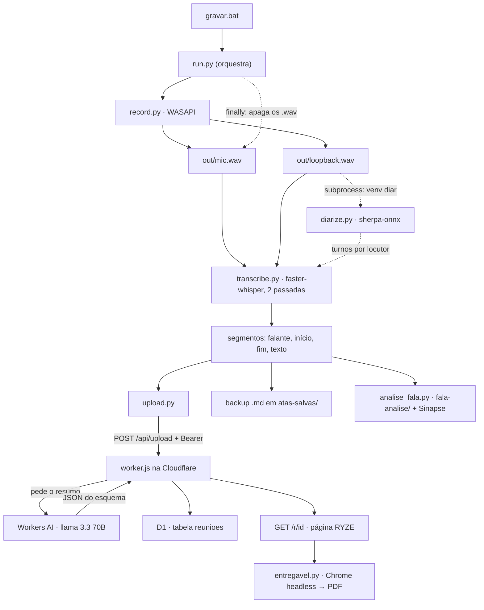

# Atas — Arquitetura e funcionamento

> Escrito em 09/09/2026 para uma pessoa entender o sistema **sozinha**, sem quem o construiu por
> perto. Cobre o caminho inteiro de uma reunião — do microfone ao link publicado — os dois
> ambientes Python que o sistema usa (e por que são dois), o que fica fora do git e o que quebra
> quando se esquece de um detalhe.
>
> O que este documento **não** é: o manual de uso do dia a dia (isso é o
> [README.md](../README.md), que é curto de propósito).

---

## 0 · Como ler

Se você tem cinco minutos, leia as seções 1, 2 e 13. Se vai mexer na captura ou na transcrição,
leia 3 a 6. Se vai mexer na página publicada, 7. Se só quer resolver um problema agora, vá para
a receita certa em 11 e para as armadilhas em 14.

---

## 1 · O sistema em um parágrafo

Um script Python roda no XPS e grava a reunião **de duas fontes físicas separadas**: o microfone
(que vira o falante "Você") e o loopback do alto-falante (que vira "Participante"). Como são dois
arquivos WAV distintos, a pergunta "quem falou?" já nasce respondida entre os dois lados, sem IA.
Cada WAV é transcrito **offline** pelo faster-whisper, e o canal do loopback ainda passa por uma
**diarização acústica** (sherpa-onnx, num segundo ambiente Python) que tenta separar os
participantes remotos em "Participante 1", "Participante 2"… Os trechos são fundidos e ordenados
por tempo, viram um único array de segmentos, e esse array é enviado por HTTP a um **Cloudflare
Worker**, que pede um resumo executivo ao **Workers AI**, guarda tudo num **D1** e devolve o link
de uma página com a marca RYZE. De volta na máquina, o script salva um backup `.md`, baixa aquela
página e imprime um **PDF** para mandar ao cliente, e roda o **Raio-X da Fala** — uma análise
pessoal e interna de como o Pedro falou, que nunca sai da máquina. **O áudio é apagado no final,
sempre** (bloco `finally`).



Três coisas nascem de uma reunião e vão para lugares diferentes, de propósito: a **página** (link
público para quem tem o endereço), o **PDF/`.md`** (entregável e backup, locais) e o **Raio-X**
(dado pessoal, interno, nunca enviado).

---

## 2 · Mapa do repositório

```
atas/
├── local/                    tudo o que roda no XPS
│   ├── gravar.bat            atalho clicável: chama run.py com o venv certo e NÃO fecha em erro
│   ├── run.py                o orquestrador: config → gravar → transcrever → publicar → entregar
│   ├── record.py             captura mic + loopback (soundcard/WASAPI) em dois WAV 16 kHz mono
│   ├── transcribe.py         faster-whisper nos dois WAV + chamada da diarização; funde e ordena
│   ├── diarize.py            CLI de diarização (sherpa-onnx) — roda no OUTRO venv, por subprocess
│   ├── upload.py             POST da transcrição no Worker (só stdlib)
│   ├── entregavel.py         baixa a página publicada e imprime PDF com Chrome headless
│   ├── analise_fala.py       Raio-X da Fala: métricas, relatório, painel HTML e nota no Sinapse
│   ├── config.example.json   modelo do config (FORA do git está o config.json real, com o token)
│   ├── config.json           FORA DO GIT — worker_url, upload_token, model e os ajustes opcionais
│   ├── out/                  FORA DO GIT — os .wav transitórios; apagados ao fim de cada execução
│   └── models/               FORA DO GIT — modelos ONNX da diarização (~35 MB) + scripts do sherpa
├── worker/                   o que roda na Cloudflare
│   ├── worker.js             arquivo único: rotas, resumo por IA, render da página, CSS embutido
│   ├── schema.sql            a única tabela: reunioes
│   └── wrangler.toml         nome do Worker, binding de AI e do D1
├── atas-salvas/              FORA DO GIT — backup .md + .html + .pdf de cada reunião (dado de cliente)
├── fala-analise/             FORA DO GIT — histórico e painel do Raio-X (dado pessoal)
├── docs/ARQUITETURA.md       este arquivo
└── README.md                 como usar no dia a dia e como montar do zero
```

Não há `package.json`: o Worker é um arquivo só e sobe com `npx wrangler`. Não há `requirements.txt`
nem `pyproject`: as dependências Python vivem em dois venvs fora do repositório (seção 5).

---

## 3 · O ciclo de vida de uma reunião

1. **Dois cliques em `local/gravar.bat`.** O `.bat` faz `cd` para a própria pasta e chama o
   `python.exe` do venv `faster-whisper` com `run.py`. Se o processo sair com código diferente de
   zero, ele imprime um aviso e dá `pause` — a janela fica aberta com o traceback na tela. Isso não
   é firula: enquanto ela fechava sozinha, um erro de driver chegava como "o botão não funciona".
2. **`run.py` carrega o config.** Sem `local/config.json`, ou sem `worker_url`/`upload_token`
   dentro dele, ele sai com uma mensagem dizendo exatamente o que falta.
3. **`record.py` escolhe os dispositivos e grava.** Duas threads, uma por fonte, lendo blocos de
   100 ms até você apertar ENTER. Escreve `out/mic.wav` e `out/loopback.wav` (PCM 16 bits, mono,
   16 kHz — o formato que o Whisper quer) e devolve um diagnóstico com duração e RMS de cada lado.
   Se algum RMS vier praticamente zerado, avisa na tela: quase sempre significa que a chamada
   estava tocando em outro dispositivo.
4. **Se os dois lados vieram com menos de 1 segundo, para por aqui.** Senão, pede o título.
5. **`transcribe.py` faz duas passadas independentes** do faster-whisper, uma por WAV, rotulando
   os trechos como "Você" e "Participante".
6. **A diarização entra só no loopback** (seção 6): `transcribe.py` chama `diarize.py` num outro
   interpretador Python, por `subprocess`, e reetiqueta os trechos de "Participante" em
   "Participante 1/2/3…" pela maior sobreposição de tempo com os turnos devolvidos.
7. **Os dois conjuntos são concatenados e ordenados por `start`.** Daqui em diante o sistema
   inteiro fala uma coisa só: uma lista de `{speaker, start, end, text}`.
8. **`upload.py` faz `POST /api/upload`** com `Authorization: Bearer <token>`. A falha aqui é
   tolerada: o `run.py` imprime o erro e segue, porque o backup local ainda vai ser salvo.
9. **O Worker resume, guarda e responde o link.** Ele monta o texto `Falante: fala`, corta em
   40 000 caracteres, manda ao Workers AI com um `json_schema` fechado, insere a linha no D1 com
   um id de 32 hexadecimais e devolve `{"url": "<origem>/r/<id>"}`.
10. **`run.py` salva o backup `.md`** em `atas-salvas/`, com carimbo de data e o título higienizado.
11. **`entregavel.py` baixa a página publicada e imprime o PDF** com o Chrome em modo headless,
    sem cabeçalho nem rodapé — então nenhuma URL aparece no arquivo que vai ao cliente.
12. **`analise_fala.py` roda o Raio-X**, atualiza `fala-analise/historico.jsonl`, regrava o painel
    `raio-x.html` e, se o vault do Sinapse existir na máquina, sobrescreve a nota de Fala lá.
13. **O `finally` apaga os dois `.wav`.** Aconteça o que acontecer — erro, Ctrl+C, upload
    quebrado — o áudio não fica guardado. É a promessa que o rodapé da página faz.

---

## 4 · Os módulos

| Arquivo | Responsabilidade | O que **não** faz |
|---|---|---|
| `local/gravar.bat` | Chamar o `run.py` com o Python certo e manter a janela aberta em caso de erro | Não conhece nada do fluxo; só o caminho do venv |
| `local/run.py` | Ler o config, orquestrar as etapas na ordem, salvar o `.md`, copiar o link, abrir os arquivos, apagar o áudio | Não grava, não transcreve, não publica: só chama quem faz |
| `local/record.py` | Escolher microfone e loopback que **abrem de verdade**, gravar em duas threads, escrever os WAV, medir RMS | Não sabe de reunião, título ou upload. Não converte formato: pede 16 kHz e deixa o WASAPI reamostrar |
| `local/transcribe.py` | As duas passadas do Whisper, a chamada da diarização e a fusão ordenada | Não decide o que vai para o cliente; não fala com o Worker |
| `local/diarize.py` | Rodar o sherpa-onnx num WAV e cuspir os turnos em JSON no stdout | Não conhece "Você" nem "Participante": devolve locutores numerados. Não roda no venv principal |
| `local/upload.py` | Um `POST` autenticado, com o erro do servidor repassado por inteiro | Não tem retry, não guarda nada, não sabe o que é uma ata |
| `local/entregavel.py` | Baixar o HTML publicado e imprimir o PDF | Não gera a página: ela vem do Worker. Sem link publicado, não há entregável |
| `local/analise_fala.py` | Métricas da fala do Pedro, relatório `.md`, `historico.jsonl`, painel HTML e nota no Sinapse | Nunca sobe nada para o Worker nem entra no PDF do cliente |
| `worker/worker.js` | As três rotas, o resumo por IA, a persistência no D1 e todo o HTML/CSS da página | Não tem build, não tem dependência, não tem CORS nem rate limit |
| `worker/schema.sql` | A tabela `reunioes` | Não tem migração: é `CREATE TABLE IF NOT EXISTS` |

---

## 5 · Os dois ambientes Python (e por que são dois)

| | Principal | Diarização |
|---|---|---|
| Caminho | `C:\Users\olive\.venvs\faster-whisper` | `C:\Users\olive\.venvs\diar` |
| Python | 3.14.6 | 3.12.13 |
| Quem usa | `gravar.bat`, e portanto `run.py`, `record.py`, `transcribe.py`, `upload.py`, `entregavel.py`, `analise_fala.py` | só `diarize.py` |
| Bibliotecas | `faster-whisper` 1.2.1, `soundcard`, `numpy` 2.5.1, PyAV | `sherpa-onnx` 1.13.4, `numpy` |
| Como é chamado | direto | `subprocess.run([...])` a partir de `transcribe.py`, com `timeout=1200` |

São dois porque as libs de áudio/ML não convivem no mesmo ambiente: o sherpa-onnx não tem roda
para o Python 3.14 em que o faster-whisper já está montado. Em vez de rebaixar o ambiente inteiro
(e arriscar a transcrição, que é o coração do sistema), a diarização foi isolada atrás de uma
fronteira de processo. O contrato entre os dois é minúsculo e por isso robusto: **um WAV de
entrada, JSON de turnos no stdout**.

`transcribe.py` procura a última linha não vazia do stdout que comece com `[` — o sherpa loga
progresso, e isso vai tudo no stderr, mas a regra existe para não quebrar se algum dia ele
escrever no lugar errado. O caminho do interpretador pode ser trocado pelo config (`diar_python`);
se o executável ou o script não existirem, a função devolve `None` e o sistema segue com um
"Participante" só. Diarização é bônus: nunca pode custar a reunião.

---

## 6 · A diarização: como funciona e onde mora o limiar

`diarize.py` monta um `OfflineSpeakerDiarization` do sherpa-onnx com duas redes, ambas em
`local/models/diar/` (fora do git, ~35 MB, baixadas uma vez dos releases do sherpa-onnx):

- **segmentação** — `sherpa-onnx-pyannote-segmentation-3-0/model.onnx`: acha onde há fala e onde a
  voz troca;
- **embedding** — `embedding.onnx` (CAM++): transforma cada trecho num vetor de voz.

Os vetores são agrupados por `FastClusteringConfig`, e é aí que mora o botão:

| Parâmetro | Config | Padrão no código | O que faz |
|---|---|---|---|
| `threshold` | `diar_threshold` | `0.5` | Distância máxima para dois trechos serem a mesma pessoa. **Maior = menos locutores.** Só vale quando o número não é fixado |
| `num_clusters` | `diar_num_speakers` | `-1` | `-1` = descobrir sozinho. Qualquer inteiro ≥ 1 **crava** a quantidade e ignora o threshold |
| — | `diarizar` | `true` | Desliga a etapa inteira |
| `min_duration_on` / `min_duration_off` | — (fixos no código) | `0.3` / `0.5` | Fala curta demais e pausa curta demais não viram turno |

Os três primeiros são lidos em `run.py` e repassados a `transcribe.py` num dict. **O
`local/config.json` que está em uso hoje não tem nenhum deles** — só `worker_url`, `upload_token` e
`model` — então valem os padrões acima. Para mudar o comportamento é preciso **acrescentar a chave**
no `config.json`, não basta editar o `config.example.json`.

A reetiquetagem acontece de volta em `transcribe.py::_rotular_participantes`: cada trecho
transcrito recebe o locutor cujo turno tem a **maior sobreposição de tempo** com ele; se não houver
sobreposição nenhuma, o turno de centro mais próximo. Os locutores são renumerados na ordem em que
aparecem no tempo (para "Participante 1" ser mesmo o primeiro a falar) e, se só sobrar um, o rótulo
volta a ser "Participante" sem número.

**Não há teto.** Se o agrupamento devolver 78 clusters, o sistema escreve 78 participantes — e foi
exatamente o que aconteceu em 08/09/2026 (seção 14).

---

## 7 · O Worker

Arquivo único, sem build, sem dependência. Três rotas:

| Rota | O que faz |
|---|---|
| `POST /api/upload` | Confere `Authorization: Bearer <UPLOAD_TOKEN>`, lê `{titulo, segments}`, resume, insere no D1, devolve `{url}` |
| `GET /r/<id>` | Busca a linha no D1 e renderiza a página da ata. Se não achar, devolve a landing com "Ata não encontrada" e status 404 |
| `GET /` | Landing simples com a marca |

Qualquer outra coisa é 404 em texto puro.

**O resumo.** `resumir()` manda system + user ao `@cf/meta/llama-3.3-70b-instruct-fp8-fast` com
`response_format: json_schema` e um esquema fechado (`contexto`, `resumo_executivo`, `temas`,
`decisoes`, `proximos_passos[{acao, responsavel, prazo}]`, `pendencias`), `max_tokens: 2048`. O
prompt explica quem é "Você" (o consultor) e manda usar nomes reais quando alguém se identificar na
conversa. Se o modelo devolver string em vez de objeto, há um fallback que recorta do primeiro `{`
ao último `}`. Se tudo falhar, o `resumo` vira `null`, a reunião é gravada assim mesmo e a página
mostra "Resumo por IA indisponível — transcrição completa abaixo": **perder o resumo é aceitável,
perder a transcrição não é**.

**O identificador é a fechadura.** O id é um `crypto.randomUUID()` sem hífens — 32 hexadecimais
não adivinháveis — e a página vai com `<meta name="robots" content="noindex">`. Não existe login,
senha nem expiração: **quem tem o link lê a ata inteira**. É o modelo de "link secreto", e é
consciente; a senha por reunião continua na lista de coisas a fazer.

**A página.** Capa preta com o símbolo RYZE em marca-d'água, resumo executivo, temas, decisões,
tabela de próximos passos (com um chip colorido por responsável), pontos em aberto e a transcrição
em bolhas — dourada e à direita para "Você", cinza e à esquerda para os demais. O CSS é uma
constante no fim do arquivo e traz um bloco `@media print` com `@page A4`: é ele que faz o PDF do
`entregavel.py` sair paginado direito, com a transcrição começando em página nova. Trocar a marca é
trocar as constantes `MARCA`, `SITE` e `LOGO_PATH` no topo.

---

## 8 · Dados: o que é guardado, onde e por quanto tempo

| Onde | O que guarda | Quem escreve | Quem lê | Está no git? |
|---|---|---|---|---|
| D1, tabela `reunioes` | `id`, `titulo`, `data` (ISO), `segments` (JSON da transcrição inteira), `resumo` (JSON ou `NULL`) | `POST /api/upload` | `GET /r/<id>` | não (é remoto) |
| `local/out/*.wav` | O áudio bruto | `record.py` | `transcribe.py`, `diarize.py` | não — e é **apagado** no `finally` |
| `atas-salvas/*.md` | Backup da transcrição com carimbo de tempo | `run.py` | você | não (`.gitignore`) |
| `atas-salvas/*.html` e `*.pdf` | O entregável do cliente | `entregavel.py` | o cliente | não (`.gitignore`) |
| `fala-analise/historico.jsonl` | Uma linha por reunião com as métricas de fala — a fonte de verdade do Raio-X | `analise_fala.py` (upsert pela chave `data\|titulo`) | o painel e a nota do Sinapse | não (`.gitignore`) |
| `fala-analise/raio-x.html` e `*.md` | Painel e relatório por reunião | `analise_fala.py` | você | não (`.gitignore`) |
| `<vault>/08-CRESCIMENTO/fala-raio-x.md` | Nota auto-gerada no Sinapse, sobrescrita a cada reunião | `analise_fala.py` | o Sinapse | outro repositório |

Não há migração: `schema.sql` é `CREATE TABLE IF NOT EXISTS` e a tabela nunca mudou. Também não há
rota de exclusão — **o áudio some, mas a transcrição fica no D1 para sempre**, até alguém apagar a
linha à mão (receita em 11).

**O Raio-X mede só o "Você"**: fatia de fala, turnos, vocabulário único, pedidos de confirmação
("né?", "entendeu?", "certo?"), muletas por mil palavras, bordões, `acho que` e as palavras de
conteúdo mais repetidas. É explicitamente uso interno, e o painel diz isso em duas linhas
diferentes.

---

## 9 · Configuração

`local/config.json` (fora do git; o modelo é `local/config.example.json`):

| Chave | Obrigatória | Padrão | Para que serve |
|---|---|---|---|
| `worker_url` | sim | — | Raiz do Worker; `upload.py` acrescenta `/api/upload` |
| `upload_token` | sim | — | Tem de ser **idêntico** ao secret `UPLOAD_TOKEN` do Worker |
| `model` | não | `small` | Tamanho do modelo Whisper (`medium` = mais preciso e bem mais lento) |
| `diarizar` | não | `true` | Liga/desliga a separação dos participantes remotos |
| `diar_threshold` | não | `0.5` | Seção 6 |
| `diar_num_speakers` | não | `-1` | Seção 6 |
| `microfone` | não | — | Trecho do nome do microfone preferido; **lido pelo código, ausente do `config.example.json`** |
| `diar_python` | não | `C:\Users\olive\.venvs\diar\Scripts\python.exe` | Interpretador da diarização; **lido pelo código, ausente do `config.example.json`** |

No lado da Cloudflare só existe um segredo, `UPLOAD_TOKEN`, criado por
`npx wrangler secret put UPLOAD_TOKEN`. O `database_id` que está no `wrangler.toml` versionado é
identificador, não credencial — sem a conta e sem o token, ele não abre nada.

**Ambientes:** só existe um. Não há homologação; `npx wrangler deploy` publica direto em
`atas.desbravando-utv.workers.dev`, na mesma conta Cloudflare que hospeda os Workers do
Desbravando.

---

## 10 · Como conferir

**Não há testes automatizados neste repositório** — nem `pytest`, nem suíte no Worker, nem
`package.json` com script de teste. A conferência é manual, e cada peça foi feita para poder ser
executada sozinha:

| Comando | Confere |
|---|---|
| `python record.py` | Que os dois dispositivos abrem e que o RMS dos dois lados não está zerado. Grava em `out/` até ENTER |
| `python transcribe.py` | Transcreve os WAV que já estiverem em `out/` e imprime os segmentos em JSON |
| `python diarize.py <wav> [threshold] [num_speakers]` | Roda a diarização isolada e mostra os turnos — é aqui que se calibra o limiar. **Precisa do Python do venv `diar`** |
| `python entregavel.py <url> <caminho_base_sem_extensao>` | Baixa e imprime o PDF de uma ata já publicada |
| `npx wrangler tail` (em `worker/`) | O log ao vivo do Worker: é onde aparece a falha do Workers AI que a página engole |

Antes de subir uma mudança no Worker, o mínimo honesto é: `npx wrangler deploy`, abrir uma ata
antiga em `/r/<id>` e conferir que a página ainda renderiza resumo, tabela e transcrição.

---

## 11 · Receitas

**Gravar uma reunião.** Deixe o áudio da chamada saindo pelo alto-falante **padrão** do Windows,
dois cliques em `local/gravar.bat`, ENTER para parar, digite o título. O link sai copiado na área
de transferência e o PDF abre sozinho.

**O gravador não abre / a janela some.** Ela não some mais: o `pause` do `.bat` segura a janela e o
traceback fica na tela. Se o erro for um `AssertionError` seco do `soundcard`, é o microfone USB
(seção 14) — o `record.py` já tenta os outros dispositivos sozinho e avisa qual escolheu.

**Corrigir "78 participantes".** Abra `local/config.json` e acrescente as chaves — elas
provavelmente não estão lá:
```json
"diarizar": true,
"diar_threshold": 0.8,
"diar_num_speakers": -1
```
Suba o `diar_threshold` até parar de fatiar (o padrão 0.5 é baixo demais para voz de loopback).
Se você **sabe** quantas pessoas remotas havia, é mais direto cravar `"diar_num_speakers": 2` —
com um inteiro ≥ 1 o threshold nem é consultado. Para calibrar sem regravar, guarde um
`loopback.wav` de teste e rode `python diarize.py loopback.wav 0.8 -1` com o Python do venv `diar`.

**Desligar a diarização de vez.** `"diarizar": false` no `config.json`. Todo mundo do outro lado
volta a ser "Participante".

**Melhorar a qualidade da transcrição.** `"model": "medium"` no `config.json`. Roda em CPU com
`int8`, então é bem mais lento; o modelo é baixado na primeira vez e fica em cache.

**Trocar a marca da página.** Constantes `MARCA`, `SITE` e `LOGO_PATH` no topo de
`worker/worker.js`, e as variáveis `--gold*` no CSS do fim do arquivo. Depois `npx wrangler deploy`.

**Trocar o modelo do resumo.** Constante `MODELO` em `worker/worker.js`. Modelos menores respondem
mais rápido e resumem pior; o esquema JSON continua valendo.

**Apagar uma ata do ar.** Não há rota para isso. Em `worker/`:
```powershell
npx wrangler d1 execute atas --remote --command "DELETE FROM reunioes WHERE id='<id>'"
```
O `.md`, o `.html` e o `.pdf` continuam em `atas-salvas/` — apague à mão se for o caso.

**Montar tudo numa máquina nova.** O passo a passo está no README (criar o D1, rodar o
`schema.sql`, pôr o secret, `npx wrangler deploy`) e, do lado local, os dois venvs da seção 5 mais
os modelos ONNX em `local/models/diar/`.

**Republicar uma ata perdida.** Não existe caminho pronto: o `upload.py` só é chamado pelo
`run.py`, e o `.md` do backup não volta a virar `segments`. Guarde o link.

---

## 12 · Vocabulário interno

| Termo | Significa |
|---|---|
| **Você** | O falante que veio do microfone — o Pedro. É o rótulo, não uma pessoa configurável |
| **Participante** | Tudo o que veio do loopback: o outro lado da chamada, mixado num canal só |
| **Loopback** | A captura do que **sai** pelo alto-falante. É como o sistema ouve o cliente sem plugin nem bot na reunião |
| **Turno** | Um intervalo `{início, fim, locutor}` devolvido pela diarização. Não tem texto |
| **Segmento** | Um trecho transcrito `{speaker, start, end, text}`. É a moeda que circula entre todos os módulos |
| **Diarização** | Separar "quem falou" dentro de um único canal de áudio, pela voz |
| **Limiar (`threshold`)** | A distância máxima para duas vozes serem consideradas a mesma pessoa. Quanto maior, menos gente o sistema enxerga |
| **Entregável** | O `.pdf` (ou `.html`) que vai ao cliente, sem link e sem URL impressa |
| **Raio-X da Fala** | A análise pessoal do Pedro sobre a própria fala. Interna, jamais enviada |
| **Ata** | A página publicada em `/r/<id>`: resumo + decisões + próximos passos + transcrição |

---

## 13 · Status em 09/09/2026

| Área | Estado | Onde conferir |
|---|---|---|
| Captura (mic + loopback) | **Pronta**, com fallback de dispositivo e aviso de canal mudo | `local/record.py` |
| Transcrição offline | **Pronta.** faster-whisper 1.2.1, modelo `small`, CPU/int8, Python 3.14.6 | `local/transcribe.py` |
| Diarização dos remotos | **Funciona, mal calibrada.** sherpa-onnx 1.13.4 no venv `diar` (3.12.13); os modelos ONNX estão na máquina | seções 6 e 14 |
| Worker, resumo e página | **Prontos** e publicados; um arquivo, sem build | `worker/worker.js` |
| Entregável PDF/HTML | **Pronto**, mas depende do upload ter dado certo (a página vem do Worker) | `local/entregavel.py` |
| Raio-X da Fala + Sinapse | **Pronto**; a nota no vault é best-effort e silenciosa se o vault não existir | `local/analise_fala.py` |
| Senha por reunião | **Não existe.** O link é a única barreira | seção 7 |
| Exclusão de ata | **Não existe rota.** Só SQL à mão | seção 11 |
| Testes automatizados | **Não existem** em nenhum dos dois lados | seção 10 |
| Homologação do Worker | **Não existe.** `deploy` vai direto para produção | seção 9 |
| Documentação no código | Os 9 fontes (7 `.py`, o `.bat` e o Worker) abrem com um cabeçalho dizendo o que são e por quê; as decisões não óbvias estão comentadas no lugar | `local/`, `worker/worker.js` |

---

## 14 · Armadilhas conhecidas

- **O limiar da diarização fatia uma pessoa em dezenas.** Em 08/09/2026 um único participante
  remoto virou **78 "Participantes"** na ata. O `diar_threshold` padrão (`0.5`) é baixo demais para
  voz que passou por codec de chamada e saiu pelo loopback: a mesma pessoa soa "diferente o
  bastante" a cada trecho, e o agrupamento abre um cluster novo. **Não há teto de locutores** em
  `_rotular_participantes` — o que o sherpa devolver, vira rótulo. O botão está no
  `local/config.json` (`diar_threshold`, ou `diar_num_speakers` para cravar a quantidade), e o
  `config.json` em uso **não tem essas chaves**, então o padrão do código é o que vale. Receita em 11.
- **Microfone USB que não reporta o formato EXTENSIBLE derruba o gravador.** O `soundcard` só
  falha na hora de abrir o dispositivo, não ao listar, e falha com um `assert` sem mensagem
  (`ppMixFormat[0][0].Format.wFormatTag == 0xFFFE`). Aconteceu em 03/09/2026 com o
  `Microphone (AB13X USB Audio)`. Já há defesa: `record.py::_abre()` testa cada dispositivo
  abrindo de verdade e escolhe **o primeiro que abre**, avisando na tela quando não é o padrão do
  Windows. O mesmo vale para o loopback.
- **Janela que fecha engolindo o traceback transforma bug em mistério.** É por isso que o
  `gravar.bat` tem `pause` no caminho de erro. Não tire.
- **Sem User-Agent de navegador, o Cloudflare barra o `urllib` com 403 "error code: 1010"** antes
  de o pedido chegar ao Worker (Bot Fight Mode). Tanto o `upload.py` quanto o `entregavel.py`
  mandam um UA de Chrome por causa disso.
- **O Edge headless não imprime PDF se já estiver aberto** — ele faz rendezvous com a instância em
  uso e sai sem produzir arquivo. Por isso o Chrome vem primeiro na lista de navegadores do
  `entregavel.py`, e por isso ele usa um `--user-data-dir` descartável.
- **O resumo enxerga no máximo 40 000 caracteres** da transcrição (`.slice(0, 40000)` no Worker).
  A transcrição completa é guardada e exibida, mas numa reunião muito longa o resumo executivo
  ignora o final.
- **A falha do Workers AI é silenciosa.** O `catch` no Worker zera o resumo e não registra o
  motivo; na tela só sobra "Resumo por IA indisponível". Para saber o que houve, `npx wrangler tail`
  **durante** o upload.
- **Quem tem o link tem a ata.** `noindex` não é controle de acesso. Cuidado ao encaminhar; o PDF
  existe justamente para não precisar mandar o link.
- **O áudio some, a transcrição não.** O `finally` apaga os `.wav`, mas o texto fica no D1 sem
  prazo e sem rota de exclusão.
- **O título da reunião vaza para o Sinapse.** A nota `08-CRESCIMENTO/fala-raio-x.md` lista as
  últimas oito reuniões **pelo título** — que costuma ter o nome do cliente. Métrica é interna, mas
  o vault é outro repositório: confira se ele não é público antes de sincronizar.
- **Sem upload não há PDF.** O `entregavel.py` baixa a página **do Worker**; se o `POST` falhou,
  sobra só o `.md`. O entregável é offline para o cliente, não para você.
- **`transcribe.py` e `record.py` rodam standalone, `diarize.py` não roda no venv principal.**
  Chamar `python diarize.py` com o Python do faster-whisper falha no `import sherpa_onnx`.
- **Recriar o banco não é preciso, mas cuidado:** `schema.sql` é idempotente
  (`CREATE TABLE IF NOT EXISTS`), então rodá-lo de novo não apaga nada — mas também não migra nada
  se um dia a tabela mudar.
