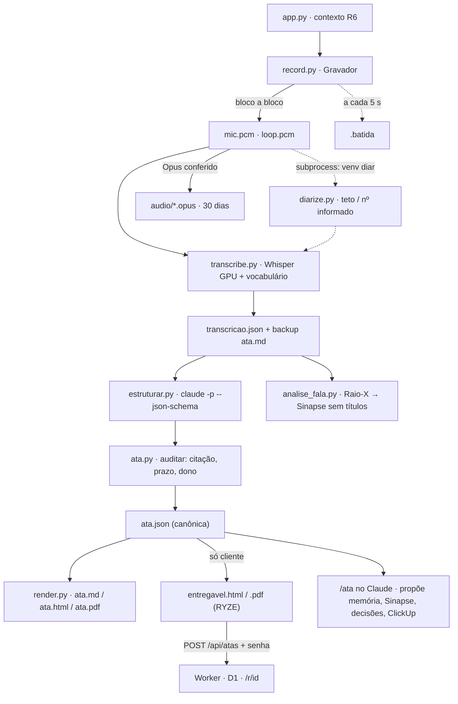

# Atas — Arquitetura e funcionamento (v2)

> Reescrito em 30/09/2026, na v2, para uma pessoa entender o sistema **sozinha**. Cobre o
> caminho inteiro de uma reunião — do microfone à ata estruturada e ao PDF —, os dois
> ambientes Python, o que fica fora do git, os números medidos e o que quebra quando se
> esquece de um detalhe. A v1 (jul–set/2026) está no histórico do git e em §15.
>
> O manual do dia a dia é o [README.md](../README.md). O contrato da v2 é
> [BRIEFING-V2.md](BRIEFING-V2.md).

---

## 0 · Como ler

Cinco minutos: §1, §2 e §13. Mexer na gravação: §3 e §4. Na transcrição e nos falantes: §5
e §6. Na ata: §7. No Worker: §10. Resolver um problema agora: §11 (receitas) e §14.

---

## 1 · O sistema em um parágrafo

Uma janela (`app.py`) pergunta o contexto da reunião — título, **tipo**, projeto e quem vai
falar do outro lado — e grava **duas fontes físicas separadas**: o microfone ("Você") e o
loopback do alto-falante ("Participante"). Cada bloco de 100 ms vai **para o disco na hora**,
num `.pcm` dentro da pasta da reunião, e uma batida a cada 5 s diz que o gravador está vivo.
Ao parar, o `pipeline.py` transcreve cada canal na GPU (faster-whisper `large-v3-turbo`, com
o vocabulário do contexto), separa as vozes do loopback (sherpa-onnx, noutro venv) usando o
número de participantes informado, e escreve um backup `.md` antes de qualquer coisa que
dependa de rede. Depois chama o **Claude Code sem interação** (`claude -p`) com um JSON Schema
fechado, e **audita** a resposta contra a transcrição: todo item precisa de uma citação
literal, e prazo sem a expressão dita vira lacuna. Da ata canônica (`ata.json`) saem o `.md`,
a página e o PDF, renderizados **na máquina**. Só reunião de **cliente** gera entregável com
marca RYZE, e só sobe para o Worker **quando o Pedro manda** (botão na tela final ou
`atas.py publicar`), com senha e expiração. O áudio é compactado em Opus e fica 30 dias
nesta máquina. O Raio-X da fala atualiza a nota do Sinapse **sem títulos**. No Claude, o
`/ata` fecha a reunião com o Pedro: nomes, lacunas e propostas — nunca publica sozinho.



---

## 2 · Mapa do repositório

```
atas/
├── local/                     tudo o que roda no XPS
│   ├── gravar.bat             atalho: abre o app.py com o venv certo; pausa se ele morrer
│   ├── app.py                 a janela (Tk): nova reunião → checagem → gravando → gerando → pronto
│   ├── atas.py                CLI: retomar, processar, listar, mostrar, buscar, falantes, publicar…
│   ├── sessao.py              a pasta da reunião, o sessao.json, a batida, órfãs
│   ├── record.py              captura em blocos no disco, reabertura, checagem, manter acordado
│   ├── audio.py               PCM ↔ Opus, conferência, retenção
│   ├── transcribe.py          Whisper (GPU→CPU), vocabulário, recorte por palavra, diarização
│   ├── diarize.py             sherpa-onnx — roda no OUTRO venv, por subprocess
│   ├── estruturar.py          prompt + claude -p → ata candidata
│   ├── ata.py                 schema atas/ata@1, auditoria "nada inventado", lacunas, log
│   ├── render.py              .md, página interna, entregável RYZE (HTML/CSS)
│   ├── entregavel.py          HTML local → PDF (Chrome headless)
│   ├── upload.py              publicação no Worker (só cliente), senha, exclusão
│   ├── pipeline.py            as etapas na ordem, idempotentes, registradas
│   ├── ao_vivo.py             transcrição incremental durante a reunião (MVP, GPU)
│   ├── analise_fala.py        Raio-X da fala + nota do Sinapse
│   ├── legado.py              importa as atas soltas de antes da v2
│   ├── config.py              padrões + config.json + onde está o claude.exe
│   ├── vocabulario.json       termos por tipo e por projeto (hotwords do Whisper)
│   ├── config.example.json    modelo do config (o real, com token, fica FORA do git)
│   └── models/                FORA DO GIT — ONNX da diarização (~35 MB)
├── worker/                    o que roda na Cloudflare
│   ├── worker.js              publicação, senha, expiração, exclusão; render das atas da v1
│   ├── migrations/            0001 (tabela da v1) + 0002 (colunas da v2)
│   ├── schema.sql             as duas migrações juntas (banco novo)
│   ├── wrangler.toml          conta FIXADA, D1, cron, ambiente homolog
│   ├── package.json + test/   só para os testes (Miniflare); o deploy não tem build
├── claude/skills/ata/         a skill /ata (junction em ~/.claude/skills/ata)
├── tests/                     pytest: 53 testes, inclusive fumaça e gravação reais (-m lento)
├── atas-salvas/               FORA DO GIT — uma pasta por reunião (§8)
├── fala-analise/              FORA DO GIT — histórico e painel do Raio-X
└── docs/                      este arquivo + BRIEFING-V2.md
```

---

## 3 · O ciclo de vida de uma reunião

A janela tem **três telas** — Nova reunião → Gravando → Pronto. Eram cinco (com uma de
checagem no meio) e o Pedro achou "um pouquinho too much" na primeira reunião real (30/09).

1. **Atalho → `gravar.bat` → `app.py`.** O console fica minimizado atrás: se o Python morrer
   antes da janela subir, o traceback fica lá e o `pause` segura. O `app.py` importa o
   `record` na thread principal, e o `record` liga a **thread guardiã do COM** (§14).
2. **Ao abrir**, `sessao.a_retomar()` procura sessão órfã (batida parada há mais de 45 s) ou
   que falhou numa etapa essencial e oferece "Terminar agora" / "Agora não".
3. **Nova reunião (R6).** Título, **tipo (obrigatório, sem valor padrão — herdar o da reunião
   anterior fazia Parresia virar cliente)** e quem fala do outro lado. Projeto, Claude e ao
   vivo ficam em "Mais opções", recolhido, com resumo de uma linha.
4. **Gravar já grava.** Numa thread, `record.escolher_dispositivos()` escolhe o microfone —
   **fone (USB/Bluetooth) antes do interno**, cada um tentado pelo `soundcard` e, se não abrir,
   pela via PortAudio — e o loopback da saída padrão. Em seguida `Sessao.criar()` faz a pasta
   e `Gravador.iniciar()` liga o "não dormir", a batida e uma thread por canal.
5. **Gravando.** Tempo, nível de cada lado, o microfone em uso ("Microfone: AB13X USB
   Audio") e alertas só quando existem: microfone mudo > 1 min, chamada muda > 3 min, canal
   que caiu ou trocou. Se os dois canais pararem, o topo vira **"✕ NÃO ESTÁ GRAVANDO"**.
6. **Parar.** Fechar a janela pergunta antes. `parar()` fecha os canais e marca `gravado`.
7. **`pipeline.processar()`** (§4) numa thread, com batida e trava.
8. **Pronto.** O resultado da ata numa linha, só as etapas que **falharam** (o resto em
   "Detalhes"), "Ver a ata", "Abrir a pasta" (Explorer com o arquivo selecionado) e, em
   cliente, "Publicar para o cliente" e depois "Copiar link e senha".
9. **No Claude, `/ata`** (§12).

---

## 4 · As etapas do pipeline

| Etapa | O que faz | Pula quando | Registro |
|---|---|---|---|
| `transcricao` | Whisper nos dois canais + diarização → `transcricao.json` | o arquivo já existe | modelo, dispositivo, trechos, segundos |
| `falantes` | resultado da diarização | — | nº de remotos, modo (informado/teto/limiar), ou o erro |
| *(backup)* | `ata.md` com a transcrição, **antes** de Claude/rede/Chrome | — | — |
| `estrutura` | `claude -p` → `ata.montar()` (auditoria) → `ata.json` | ata já estruturada; `estruturar: false` | contagens, custo, ou o motivo |
| `render` / `pdf` | `ata.md`, `ata.html`, `ata.pdf`; em cliente estruturada, `entregavel.*` | — | arquivos |
| `publicacao` | **não publica sozinha**: fica `pendente` até o Pedro mandar; atualiza a página se ela já está no ar; tipo interno com página no ar → apaga | tipo interno; sem entregável | URL, pendente, ou o erro |
| `raio_x` | métricas + painel local + nota do Sinapse | reunião legada | se a nota foi escrita |
| `audio` | PCM → Opus, confere a duração, apaga o PCM; aplica a retenção só às reuniões com **ata garantida** (estruturada, com falas, sem etapa essencial falhada), contando de `processado_em` | sem PCM | MB, dias |

**Idempotente e retomável:** rodar `processar()` de novo só faz o que falta. **Uma execução
por sessão**: `.processando.lock` (O_EXCL) impede a janela e o /ata de processarem a mesma
reunião ao mesmo tempo. Refazer transcrição ou ata guarda a anterior em `ata.antes-*.json`. Uma exceção
numa etapa vira `falhou` com o motivo (e o traceback em `erros.log` da pasta), e as etapas
seguintes que não dependem dela rodam. Estado final: `pronto` ou `pronto_com_falhas`; a janela
e o `retomar` oferecem de novo as sessões órfãs, as `falhou` e as `pronto_com_falhas` em etapa
essencial (transcrição, ata, página, PDF).

---

## 5 · Os dois ambientes Python

| | Principal | Diarização |
|---|---|---|
| Caminho | `C:\Users\olive\.venvs\faster-whisper` | `C:\Users\olive\.venvs\diar` |
| Python | 3.14.6 | 3.12.13 |
| Quem usa | tudo, menos `diarize.py` | só `diarize.py` |
| Bibliotecas | `faster-whisper` 1.2.1 (ctranslate2 4.8.1), `soundcard` 0.4.6, `sounddevice` 0.5.6 (PortAudio), `numpy` 2.5.1, `av` 18, `pytest`, `pillow`, **`nvidia-cublas-cu12` 12.9 + `nvidia-cudnn-cu12` 9.27** | `sherpa-onnx` 1.13.4, `numpy` |

São dois porque o sherpa-onnx não tem roda para o 3.14. O contrato entre eles é minúsculo:
um arquivo de áudio (`.pcm` ou `.wav`) de entrada, uma linha JSON no stdout
(`{turnos, falantes, modo, brutos}`).

**GPU.** O ctranslate2 enxerga a RTX 3050 Ti, mas precisa das DLLs do cuBLAS 12 e do cuDNN 9.
Elas vêm dos pacotes pip `nvidia-*` dentro do venv, e `transcribe._preparar_cuda()` põe as
pastas `site-packages/nvidia/*/bin` no caminho de DLLs antes de carregar o modelo. O
aquecimento (1 s de silêncio) é o que revela a falta de DLL — o construtor não falha. Se a
GPU falhar, cai para CPU/int8 e o motivo vai para o `sessao.json`.

**Medido em 30/09/2026** (5 min de áudio sintético com codec de chamada, cada modelo em
processo isolado):

| Modelo | Dispositivo | Segundos por minuto de áudio |
|---|---|---|
| `small` (o da v1) | CPU int8 | 11,8 |
| `small` | GPU fp16 | 1,8 |
| `large-v3-turbo` | GPU fp16 | 2,3 |

`model: "auto"` usa o `large-v3-turbo` na GPU e o `small` na CPU. O WER desse corpus
(inglês, vozes SAPI) ficou em ~3% para todos — é limpo demais para diferenciar qualidade. **O
WER em pt-BR ainda não foi medido**: precisa de áudio real, que agora fica guardado (§8).

**Recorte por palavra.** Com vocabulário (`hotwords`), o turbo para de emitir os tempos
intermediários e devolve um trecho para até 30 s de fala (medido: 4 falas → 1 trecho, as
mesmas 52 palavras). Por isso a transcrição pede `word_timestamps=True` e
`transcribe._recortar()` refaz os trechos cortando em pausa ≥ 0,6 s ou fim de frase.

---

## 6 · Falantes: diarização e nomes

`diarize.py` usa duas redes em `local/models/diar/`: segmentação (pyannote 3.0, ONNX) e
embedding (CAM++). O agrupamento é o botão sensível.

**Como o número de falantes remotos é decidido:**

| Participantes informados na partida | O que acontece |
|---|---|
| 1 | não diariza: todo o loopback é aquela pessoa, **com nome confirmado** |
| 2 ou mais | `num_clusters` = esse número (o limiar nem é consultado) |
| nenhum | agrupa pelo limiar (`diar_threshold`, padrão **0,7**) e aplica o **teto**: só conta como pessoa o grupo com ≥ 5% da fala **e** ≥ 20 s; se sobrar menos grupos do que o agrupamento abriu, roda de novo cravando esse número (máximo `diar_max_falantes`, 6) |

**Por quê.** Nas 27 reuniões de jul–set/2026, **todas as 20 gravadas depois de ligar a
diarização saíram fatiadas** (de 5 rótulos numa reunião de 5 min a 79 em 08/09), porque o
limiar 0,5 não tinha teto. No corpus sintético (2 vozes, codec Opus 12 kbps), o limiar 0,5
abriu 10 grupos para 2 vozes; 0,7 + teto acertou a contagem com 2 vozes e com 1. Mas o acerto
por tempo de fala ficou baixo mesmo com a contagem certa (~0,58 contra um teto de ~0,80 dado
pelo VAD), e com 1 voz o limiar 0,8–0,9 ainda abriu 2 grupos. **Conclusão: informar os
participantes é o caminho confiável; o limiar é o plano B e precisa de calibragem em áudio
real** — `atas.py calibrar <id>` roda vários limiares no áudio guardado de uma reunião.

**Nomes.** `ata.participantes_iniciais()` sabe sozinho que "Você" é o `meu_nome` e que, com
um remoto informado, "Participante" é ele. O resto o Claude **deduz** do texto (vocativos,
apresentações), com a evidência, e fica `confirmado: false` até o Pedro confirmar no `/ata`
(`atas.py falantes <id> "Participante 1=Valter"`). Vários rótulos podem virar o mesmo nome.
O entregável ao cliente só mostra nome confirmado; a versão interna mostra "Valter?".

---

## 7 · A ata estruturada

**Quem gera.** `estruturar.chamar_claude()` roda o `claude.exe` da extensão do VS Code (o mais
novo em `~/.vscode/extensions/anthropic.claude-code-*`, ou `claude_cli` no config) com:
`-p <prompt> --output-format json --json-schema <ESQUEMA_CLAUDE> --tools "" --no-session-persistence
--strict-mcp-config --setting-sources ""`, a transcrição no stdin e o cwd numa pasta
temporária. Sem ferramentas, sem MCP, sem CLAUDE.md, sem chave de API (usa o login do Claude
Code). Medido em 30/09: reunião real de 66 min (57 mil caracteres) → 100 s, US$ 0,49 de custo
de lista; 28 itens, **28 com a citação localizada**.

**O prompt** (`VERSAO_PROMPT`, hoje "2") dá o contexto (data com dia da semana, tipo, papel
do Pedro, participantes informados, o aviso de que a diarização erra) e sete regras: citação
literal de uma fala + timestamp em todo item; null para o que não foi dito; prazo em
AAAA-MM-DD **com a expressão dita** copiada; só as falas de "Você" são do Pedro; decisão ≠
sugestão; nomes só com evidência.

**A auditoria** (`ata.auditar`, roda na criação e em todo `render`):

| Conferência | Se falhar |
|---|---|
| a citação está numa fala da transcrição (normalizada, **com limite de palavra**; reticências separam partes e TODAS precisam estar na mesma fala) | `verificado: false` + lacuna; não vai ao cliente |
| a fala achada está a ≤ 5 s do `t` informado | `t` corrigido, anotado em `problemas` |
| `prazo`/`revisar_em`: a expressão dita aparece **na transcrição** a ≤ 2 min da fala (a citação não conta: quem a escreve é o Claude) **e** a data bate — entre a reunião e 400 dias; "dia N" = o próximo dia N (≤ 62 dias); dia da semana confere (≤ 14 dias); "N/M" confere | o campo vira null (lacuna) |
| `dono`/`quem` aparece nos participantes ou na transcrição | anotado em `problemas` |

Campo preenchido pelo Pedro depois da reunião entra em `manual: ["prazo"]` e não é
auditado. **Lacunas** (calculadas, nunca escritas à mão): encaminhamento sem dono ou prazo,
decisão sem data de revisão, falante relevante sem nome ou a confirmar, item sem origem.

**Schema `atas/ata@1`** — ver o cabeçalho de `local/ata.py`. As decisões têm o mesmo formato
do log `qa-parresia/rotinas/decisoes.jsonl` mais a origem: `atas.py decisoes <id>` imprime as
linhas prontas, para o log de decisões e o painel de PO consumirem.

**Renderização** (`render.py`): decisões e encaminhamentos primeiro, resumo em seguida,
temas/perguntas/riscos/lacunas e a transcrição recolhidos (`<details>`, abertos no PDF).
Interna = neutra, "Atas · uso interno". Entregável = marca RYZE, só verificado, só nome
confirmado (também em `dono`/`quem` escritos por nome), sem lacunas; resumo e contexto — prosa
que a auditoria não confere — só entram quando todos os falantes relevantes estão confirmados.

---

## 8 · Dados: o que fica onde, e por quanto tempo

| Onde | O quê | Quanto tempo | No git? |
|---|---|---|---|
| `atas-salvas/<id>/sessao.json` | contexto, estado, etapas, avisos, publicação (com a senha) | sempre | não |
| `atas-salvas/<id>/*.pcm` | áudio cru durante a gravação | até o Opus conferir | não |
| `atas-salvas/<id>/audio/*.opus` | áudio compactado (~12 MB/100 min/canal) | **`audio_reter_dias` = 30**, depois apagado | não |
| `atas-salvas/<id>/transcricao.json`, `ata.json`, `ata.*`, `entregavel.*` | transcrição, ata e renderizações | sempre (local) | não |
| `atas-salvas/<id>/ao-vivo.md` | transcrição preliminar, se ligada | sempre (local) | não |
| D1 `reunioes` (Worker) | **só cliente**: HTML do entregável, hash da senha, expiração | **`publicacao_reter_dias` = 90** (cron diário) | não |
| D1 — linhas da v1 | segments + resumo das atas antigas (26 das 27 têm link no backup .md) | **sem prazo** até alguém decidir (§14) | não |
| `fala-analise/` | histórico e painel do Raio-X (com títulos) | sempre (local) | não |
| `sinapse/08-CRESCIMENTO/fala-raio-x.md` | métricas por **data + tipo**, sem título | sobrescrita a cada reunião | outro repo |

**Parresia, carreira e pessoal nunca sobem.** A única coisa que sai da máquina numa reunião
interna é a transcrição indo ao Claude para ser estruturada — o mesmo que acontece quando o
Pedro cola texto no chat. Para nem isso sair, desmarque "Gerar a ata com o Claude" em "Mais
opções".

---

## 9 · Configuração

`local/config.json` por cima dos padrões de `local/config.py`. **Nenhuma chave é
obrigatória para gravar.**

| Chave | Padrão | Para que serve |
|---|---|---|
| `meu_nome` | `Pedro` | nome de "Você" na ata |
| `worker_url`, `upload_token` | — | só para publicar cliente; o token = secret `UPLOAD_TOKEN` do Worker |
| `model` | `auto` | `auto` = turbo na GPU / small na CPU; ou um nome do faster-whisper |
| `dispositivo` | `auto` | `auto` · `cuda` · `cpu` |
| `vocabulario` | `true` | hotwords de `vocabulario.json` + participantes |
| `idioma` | `pt` | idioma do Whisper (os testes usam `en`) |
| `diarizar` | `true` | liga a separação dos remotos |
| `diar_threshold` | `0.7` | §6 |
| `diar_max_falantes` | `6` | teto |
| `diar_python` | venv `diar` | interpretador da diarização |
| `microfone` | — | trecho do nome do microfone preferido |
| `estruturar` | `true` | chamar o Claude no fim |
| `claude_cli`, `claude_modelo`, `claude_timeout_s` | achado sozinho · padrão da conta · 1200 | §7 |
| `audio_reter_dias` | `30` | retenção do áudio local |
| `publicacao_reter_dias` | `90` | expiração da página do cliente |
| `ao_vivo`, `ao_vivo_janela_s` | `false`, `30` | §12 |

---

## 10 · O Worker

Arquivo único, sem build. **Só publica** — não resume nem renderiza (a v1 fazia as duas
coisas; o Workers AI saiu).

| Rota | Auth | O que faz |
|---|---|---|
| `POST /api/atas` | Bearer | `{chave, titulo, html, senha, expira_dias}`; **senha obrigatória**; **idempotente por `chave`** (id da sessão): republicar atualiza a mesma URL |
| `GET /api/atas` | Bearer | lista id, título, data, expiração, se tem senha, se é da v1 |
| `PATCH /api/atas/<id>` | Bearer | troca senha e/ou expiração (serve para proteger as atas da v1) |
| `DELETE /api/atas/<id>` | Bearer | apaga |
| `GET /r/<id>` | senha | sem cookie válido → formulário; com → a página |
| `POST /r/<id>` | — | confere a senha, grava cookie `ata_<id>` = `emitido.HMAC(id:hash:emitido)` (`Path=/r/<id>`, HttpOnly, Secure); os 30 dias são conferidos no servidor, e trocar a senha invalida todos |
| cron `17 9 * * *` | — | apaga o que passou de `expira_em` |

**Senha**: 8 caracteres de um alfabeto sem ambíguos (≈ 40 bits), gerada na máquina, guardada
no `sessao.json`, como `sha256(sal:senha)` no D1. Aleatória e longa o bastante para o risco ser
adivinhação online, não quebra de hash — daí SHA-256 e não PBKDF2, que estouraria o limite de
CPU do plano gratuito. Erro de senha custa 400 ms.
**Cabeçalhos**: CSP `default-src 'none'` (a página não tem script), `noindex`, `no-store`,
`no-referrer`, `frame-ancestors 'none'`.
**Conta fixada** no `wrangler.toml` (`account_id` da ryzecode08): sem isso o deploy vai para a
conta do login ativo (§14).

---

## 11 · Receitas

Todas com `$A = "C:\Users\olive\.venvs\faster-whisper\Scripts\python.exe C:\Users\olive\Projetos\atas\local\atas.py"`
e `Invoke-Expression "$A <comando>"`.

**Gravar sem a janela.** `gravar` (pergunta o contexto no terminal).

**O PC travou / a janela fechou.** Abra o Atas: ele oferece gerar a ata. Ou `retomar`.

**A ata saiu `pendente` (Claude falhou).** `processar <id> --forcar estrutura`.

**Retranscrever com outro modelo.** Ponha `"model": "..."` no config e
`processar <id> --forcar transcricao,estrutura` (só enquanto o áudio existir: 30 dias).

**Nomear falantes.** `falantes <id> "Participante 1=Valter" "Participante 2=Valter"`, depois
`confirmar <id>`. Regera tudo e republica a página do cliente se ela já estava no ar.

**Calibrar a diarização em voz real.** `calibrar <id> [--limiares 0.5,0.7,0.9]` numa reunião
com áudio guardado, com o número real de pessoas conhecido. Ajuste `diar_threshold`.

**Achar algo dito.** `buscar <termo> [--pessoa X] [--projeto P] [--tipo T]`.

**Publicar / tirar do ar.** `publicar <id>` (só cliente; recusa página já apagada sem `--forcar`
e reunião antiga com tipo inferido), `despublicar <id>`, `publicadas`.

**Corrigir o tipo/projeto.** `tipo <id> cliente --projeto instituto-automacao` (marca a
classificação como confirmada; mudar para interno tira a página do ar).

**Homologação do Worker (uma vez).** Em `worker/`:
```powershell
npx wrangler d1 create atas-homolog          # cole o database_id em [env.homolog] do wrangler.toml
npx wrangler d1 migrations apply atas-homolog --remote --env homolog
npx wrangler secret put UPLOAD_TOKEN --env homolog
npx wrangler deploy --env homolog            # → atas-homolog.desbravando-utv.workers.dev
```
**Deploy em produção.** `npm test` → `npx wrangler deployments list` (conferir a conta e a
versão no ar) → `npx wrangler d1 migrations apply atas --remote` → `npx wrangler deploy` →
abrir uma ata antiga em `/r/<id>` e uma nova.

**Proteger/expirar as atas da v1 que estão no ar** (depois do deploy da v2). `legado-proteger`
mostra o plano — apagar as internas (hoje 4: Parresia e pessoal); senha nova + 90 dias para as
de cliente (22) — e só executa com `--aplicar`. As senhas novas ficam no `sessao.json` de cada uma.

**Montar numa máquina nova.** README, seção "Montar do zero".

---

## 12 · O /ata e o ao vivo

**`/ata`** (skill em `claude/skills/ata/SKILL.md`, ligada em `~/.claude/skills/ata`): acha a
reunião → confirma quem é quem → fecha lacunas (com `manual`) → compara com a reunião anterior
do mesmo projeto (`anterior <id>`) → **propõe**, pelo tipo: memória do Claude, log de decisões
(`decisoes <id>`), Sinapse (nunca para Parresia) e cards de ClickUp (só pelos wrappers com o
token do Pedro, nunca pelo MCP). Nada é publicado sem o sim dele, na hora.

**Ao vivo (MVP, R9).** Com "Transcrição ao vivo" marcada, `ao_vivo.py` transcreve a cada 30 s
o áudio novo dos dois `.pcm` com o `small` na GPU e acrescenta as falas em `ao-vivo.md`.
`atas.py ao-vivo` dá o caminho, e o Claude lê durante a reunião. Sem GPU fica desligado (na CPU
disputaria processador com a chamada). Não substitui a transcrição final.

---

## 13 · Status em 30/09/2026

| Área | Estado | Onde conferir |
|---|---|---|
| Gravação em blocos + retomada + checagem + indicador | **pronta**, testada com dispositivo falso (inclusive queda e reabertura) | `record.py`, `tests/test_gravacao.py` |
| GPU + turbo + vocabulário + recorte | **pronta**, medida (§5) | `transcribe.py`, `tests/test_fumaca.py` |
| Diarização com teto e nº informado | **pronta**; limiar **calibrado só em sintético** | §6, `atas.py calibrar` |
| Ata estruturada pelo Claude + auditoria | **pronta**, testada numa reunião real de 66 min | `estruturar.py`, `ata.py` |
| Render local, PDF sem upload, marca por tipo | **pronto** | `render.py` |
| Worker v2 (senha, expiração, exclusão, idempotência) | **pronto e testado localmente (10 testes)**; **não publicado** (§14) | `worker/` |
| /ata, índice (`buscar`), log de decisões | **prontos** | `claude/skills/ata`, `atas.py` |
| Raio-X sem título no Sinapse | **pronto**; nota regravada | `analise_fala.py` |
| 27 atas antigas | **importadas** como sessões `legado`, tipo/projeto **inferidos**; sem áudio; ainda não estruturadas | `legado.py` |
| Testes | 53 em Python (2 com os dispositivos reais) + 10 no Worker | `tests/`, `worker/test/` |
| Ao vivo | MVP pronto, **não testado numa reunião real** | `ao_vivo.py` |
| Domínio próprio | adiado | README da v1 / memória |

---

## 14 · Armadilhas conhecidas

- **Login do wrangler trocado.** Desde 28/09/2026 existe `~/.wrangler/`, e o wrangler 4.145
  prefere esse diretório ao perfil XDG: o login padrão desta máquina virou a conta **pessoal**
  (oliveiramichaelpedro), e o truque `XDG_CONFIG_HOME` parou de funcionar. O `atas` tem
  `account_id` fixado, então um deploy com o login errado **falha** (erro 10000) em vez de ir
  para a conta errada. `eventos`, `minidrive`, `mesa-arton` e `bailado-da-sanfona` **não têm**
  `account_id` fixado.
- **O turbo com vocabulário junta trechos** (§5). Não tire o `word_timestamps`.
- **Limiar de diarização sem teto fatia uma pessoa em dezenas** (§6). O teto e o número
  informado existem por isso.
- **Microfone USB sem formato EXTENSIBLE derruba o `soundcard`** num `assert` seco. É o
  **fone do Pedro**, `Microphone (AB13X USB Audio)` (03/09 e 30/09/2026). Até a v2 o sistema
  caía para o microfone do notebook; agora `record.MicPortAudio` abre o mesmo dispositivo pelo
  PortAudio (WASAPI com `auto_convert`), e o fone ganha do interno na escolha.
- **COM do Windows morre com a thread que o iniciou** (0x800401F0, CO_E_NOTINITIALIZED). O
  `soundcard` inicializa o COM só na thread que o importa; na janela era a thread da checagem,
  que terminava — e a **primeira reunião real da v2 (30/09, 4 min) gravou 0 bytes**, até ler
  `.name` de um dispositivo falhava. Conserto: thread guardiã que segura o MTA do processo
  (`record._guardiao_com`) + `com_na_thread()` em toda thread que abre dispositivo. O teste
  `tests/test_dispositivos_reais.py` (lento) grava de verdade nessa mesma sequência de threads —
  os testes com dispositivo falso não tinham como pegar isso.
- **Sem User-Agent de navegador o Cloudflare barra o `urllib`** com 403 "error code: 1010"
  (Bot Fight Mode). `upload.py` manda UA de Chrome.
- **O Edge headless não imprime se já estiver aberto.** Chrome primeiro, perfil descartável.
- **`diarize.py` não roda no venv principal** (`import sherpa_onnx` falha).
- **O `soundcard` preenche silêncio do loopback com zeros** medindo o tempo; a linha do tempo
  só escorrega se o dispositivo cair — e aí `Canal._preencher_lacuna()` compensa.
- **As 27 atas da v1 continuam no D1 sem senha e sem prazo** (quem tem o link lê), inclusive a
  de 22/09 da Parresia (frota). Decidir: proteger com senha, expirar ou apagar.
- **O vault guarda os títulos antigos no histórico do git.** A nota nova não tem títulos, mas
  os commits anteriores do `sinapse` têm. Reescrever histórico é decisão do Pedro.
- **Tk sem DPI fica borrado** na tela do XPS; `app._dpi_nitido()` e `_p()` (espaço escalado)
  existem por isso.
- **Os PCM ficam abertos pelo gravador**: não mova a pasta da reunião enquanto grava.
- **`os.replace` no Windows falha se alguém estiver lendo o arquivo** (WinError 5). O
  `sessao.json` é escrito com temporário de nome único, lock e novas tentativas.
- **Escape em script gerado por script.** Duas vezes nesta v2 um `\b` ou `\x00` escrito
  por heredoc virou caractere de controle dentro do `.py`. Edite fonte com o editor.
- **Revisão adversarial de 30/09/2026** achou 16 pontos (prazo inventado passando pela
  auditoria, nome não confirmado indo ao cliente, publicação automática com tipo herdado,
  página apagada voltando, retenção apagando áudio de ata não pronta, dois processamentos
  simultâneos perdendo áudio…). Os confirmados foram corrigidos e ganharam teste.

---

## 15 · O que mudou da v1 para a v2

| v1 (jul–set/2026) | v2 (30/09/2026) |
|---|---|
| áudio na memória, WAV só no fim — um crash perdia tudo | blocos no disco, batida, retomada |
| `small` na CPU | `large-v3-turbo` na GPU, CPU como reserva |
| diarização sem teto (até 79 rótulos) | nº informado, ou limiar 0,7 + teto |
| resumo em prosa pelo Llama 70B, 40 mil caracteres, falha silenciosa | `ata.json` pelo Claude, sem corte, auditado, falha registrada |
| página e PDF vinham do Worker; sem upload não havia PDF | tudo renderizado na máquina |
| toda ata subia, com marca RYZE | só cliente sobe; interno fica local e neutro |
| link público eterno | senha por ata, expiração de 90 dias, rota de exclusão |
| Sinapse listava reuniões pelo título | data + tipo |
| sem testes, deploy direto em produção | 63 testes, homologação configurada |
