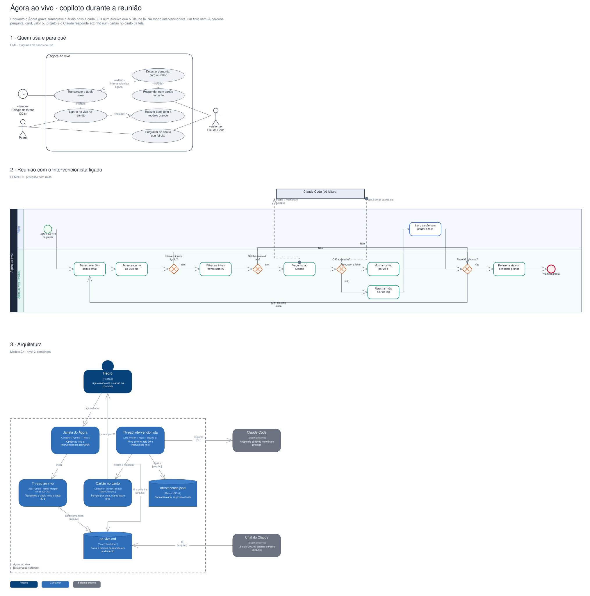
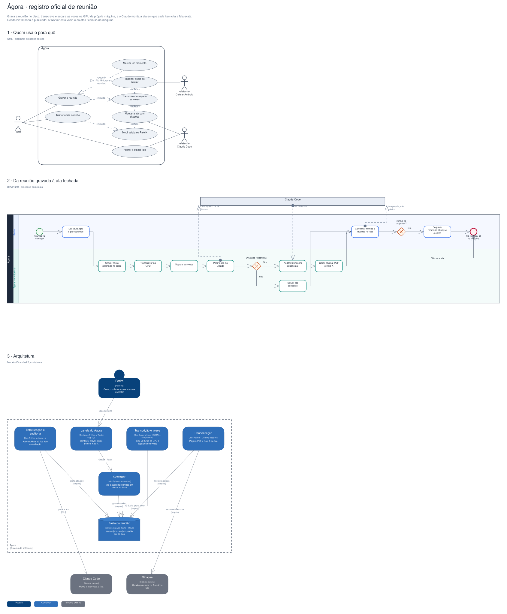

# Arquitetura

Diagramas gerados a partir do Sinapse (o segundo cérebro do Pedro). Cada projeto tem três vistas,
cada uma numa notação padrão:

1. **Quem usa e para quê**: UML, diagrama de casos de uso.
2. **O processo principal**: BPMN 2.0, com raias por quem executa.
3. **A arquitetura**: modelo C4, nível 2 (containers).

## Ágora ao vivo · copiloto durante a reunião

Enquanto o Ágora grava, transcreve o áudio novo a cada 30 s num arquivo que o Claude lê. No modo intervencionista, um filtro sem IA percebe pergunta, card, valor ou projeto e o Claude responde sozinho num cartão no canto da tela.

Editável: [`atas-ao-vivo.excalidraw`](./atas-ao-vivo.excalidraw), abre em [excalidraw.com](https://excalidraw.com) ou no VS Code com a extensão Excalidraw.

## Ágora · registro oficial de reunião

Grava a reunião no disco, transcreve e separa as vozes na GPU da própria máquina, e o Claude monta a ata em que cada item cita a fala exata. Desde 22/10 nada é publicado: o Worker está vazio e as atas ficam só na máquina.

Editável: [`atas.excalidraw`](./atas.excalidraw), abre em [excalidraw.com](https://excalidraw.com) ou no VS Code com a extensão Excalidraw.

A fonte destes arquivos é o vault do Sinapse (`09-DESENHOS/`); alterações feitas aqui são sobrescritas na próxima publicação.
