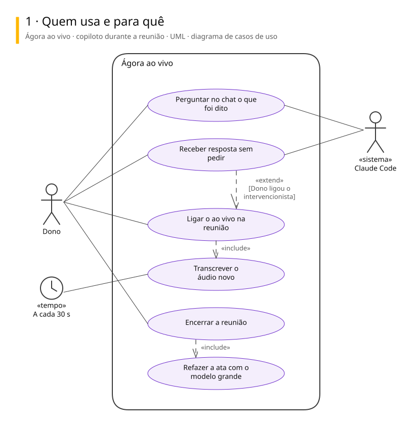
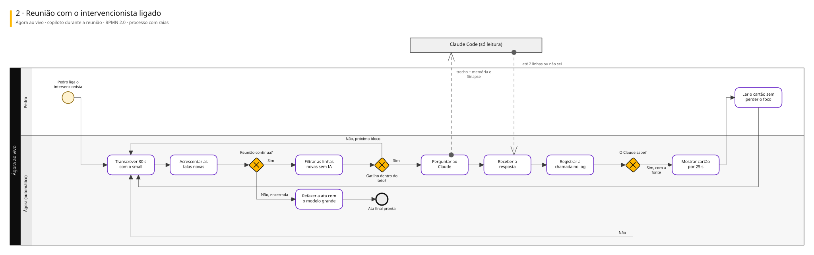
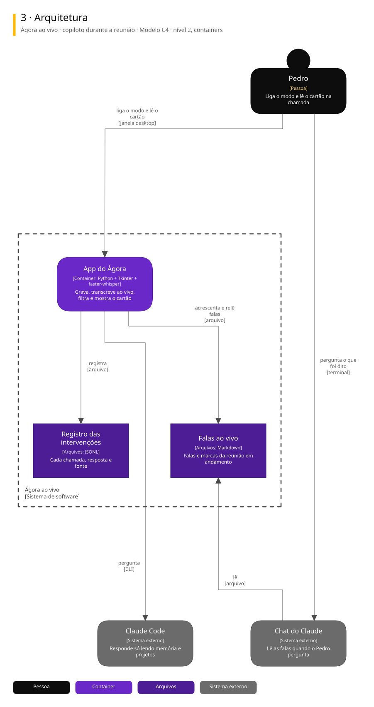
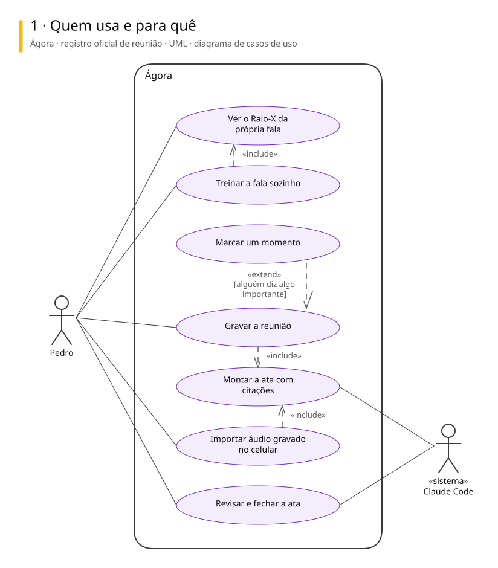
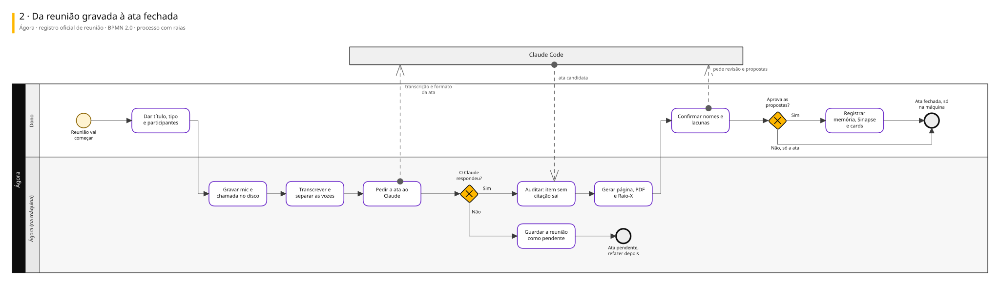
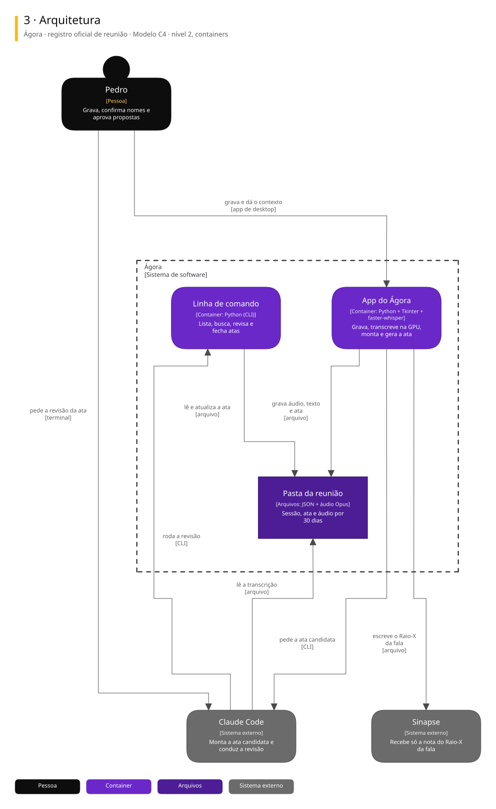

# Arquitetura

Diagramas de 2 sistemas ligados a este repositório. Cada um tem três vistas, cada vista numa notação padrão.

| Vista | Notação | Responde |
|---|---|---|
| 1. Casos de uso | UML | Quem usa e para quê |
| 2. Processo | BPMN 2.0 | Como o trabalho anda, com uma raia para cada quem executa |
| 3. Arquitetura | C4, nível 2 | De que partes o sistema é feito e com quem conversa |

## Ágora ao vivo · copiloto durante a reunião

Enquanto o Ágora grava, transcreve o áudio novo a cada 30 s num arquivo que o Claude lê. No modo intervencionista, um filtro sem IA percebe pergunta, card, valor ou projeto e o Claude responde sozinho num cartão no canto da tela.

### 1. Quem usa e para quê

### 2. Reunião com o intervencionista ligado

### 3. Arquitetura

Para editar: [agora-ao-vivo.excalidraw](./agora-ao-vivo.excalidraw), que abre em [excalidraw.com](https://excalidraw.com) ou na extensão Excalidraw do VS Code.

## Ágora · registro oficial de reunião

Grava a reunião no disco, transcreve e separa as vozes na GPU da própria máquina, e o Claude monta a ata em que cada item cita a fala exata. Desde 22/10 nada é publicado: o Worker está vazio e as atas ficam só na máquina.

### 1. Quem usa e para quê

### 2. Da reunião gravada à ata fechada

### 3. Arquitetura

Para editar: [agora.excalidraw](./agora.excalidraw), que abre em [excalidraw.com](https://excalidraw.com) ou na extensão Excalidraw do VS Code.

## De onde vêm

Os diagramas são gerados a partir do Sinapse, o vault onde o Pedro organiza notas e projetos. Mudança feita direto aqui some na próxima publicação: o lugar de mudar é a especificação no Sinapse.
